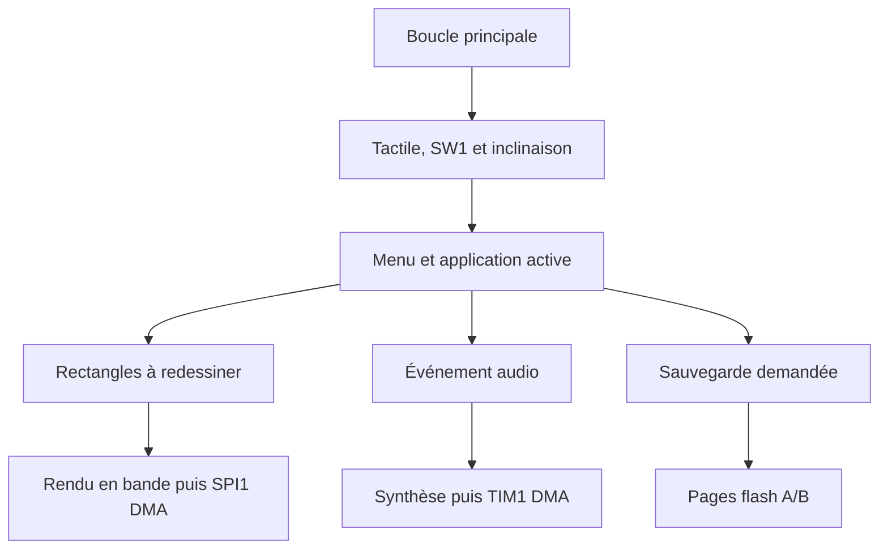
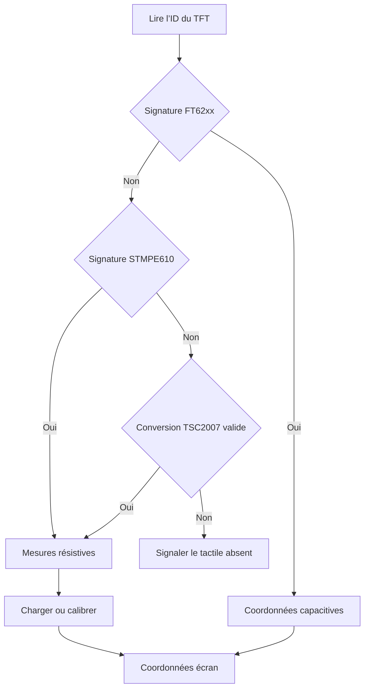
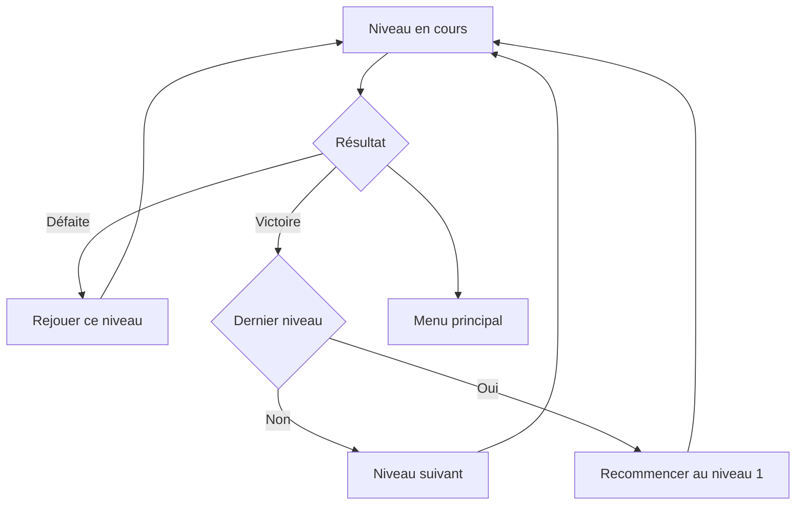
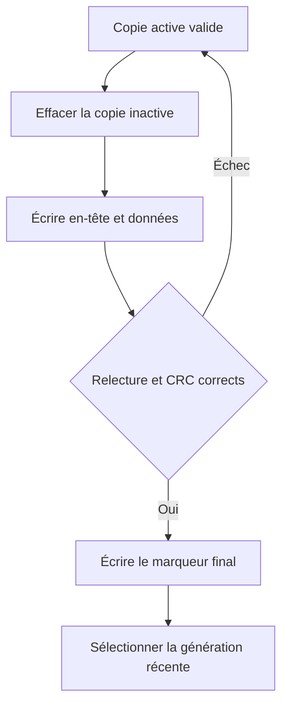

# Architecture du firmware

Pour une première lecture, suivre [le parcours pas à pas](LIRE_LE_CODE.md). Le [guide des pilotes](PILOTES.md) développe les échanges HAL et le [guide des conventions](CONVENTIONS.md) explique contrats, unités et propriété des tampons.

Le point d’entrée généré prépare les horloges, GPIO, DMA, SPI, I²C et TIM1. `obcp_start()` initialise les modules applicatifs. `obcp_task()` s’exécute ensuite continuellement. Le tactile et l’accéléromètre visent un départ d’échantillonnage toutes les 10 ms. Le résultat tactile peut être différé par la conversion du TSC2007 ou par une bande DMA. Les jeux avancent par pas fixes de 20 ms.

| Module | Rôle à la lecture |
| --- | --- |
| `board.c` | Lecture des entrées, cadence des tâches, impulsion de LED et compteurs `obcp_live`. |
| `ili9341.c` | Commandes TFT, lecture de l’identifiant et DMA de SPI1. |
| `touch_port.c`, `ft6206.c`, `stmpe610.c`, `tsc2007.c` | Reconnaissance et acquisition de mesures brutes. |
| `input.c` et `calibration.c` | Filtrage, événements de contact, calibrage résistif, SW1 et conversion de l’inclinaison vers les axes écran. |
| `gfx.c` | Primitives RGB565, clipping, fusion et transport des zones modifiées. |
| `app.c` | Écrans, événements, retour au menu, dialogues et requêtes de sauvegarde. |
| `maze.c`, `breakout.c` et `race.c` | Modèles physiques et rendu propres à chaque jeu. |
| `paint.c` | Canevas indexé, tailles de trait, palette éditable et formats de sauvegarde. |
| `logo.c` | Logo fourni, converti et compressé en ressource flash par lignes. |
| `audio.c` et `pwm_audio.c` | Séquenceur, DDS, mélange, minuterie et anneau DMA audio. |
| `storage.c` et `flash_port.c` | Format stable, politique A/B, adaptation aux pages et à l’ECC du STM32. |

## Le trajet d’un pixel

L’écran complet occuperait 153 600 octets en RGB565. Le tableau `Renderer.buffer` est dimensionné à `320 × 16 × 2 = 10 240 octets`. L’application signale l’ancienne et la nouvelle emprise d’un objet. Le moteur fige une liste de rectangles pour le lot courant et découpe chaque rectangle en bandes de 16 lignes au maximum. Chaque bande est recomposée dans le tampon, puis envoyée par SPI1 sur DMA1 canal 3, requête 1.

La boucle dessine uniquement lorsque le DMA précédent a rendu le tampon. Les nouvelles invalidations vont dans la liste en attente. Si un objet bouge pendant une série de bandes, ses anciennes et nouvelles positions seront recomposées au passage suivant. Ce découpage évite de laisser des pixels d’un sprite dans l’image et rend l’accès au tampon vérifiable. La page de test compare l’image finale au rendu complet, pixel par pixel.

À 8 Mbit/s, une image complète exige au moins 153,6 ms de transfert. Un lot de course représentatif de la recette PC envoie en moyenne 2 932 pixels, soit environ 5,9 ms de données brutes. Les commandes SPI, le dessin et les interruptions s’y ajoutent. Le compteur `obcp_live.frames_per_second` mesure les lots terminés sur carte. La cible de 25 lots/s s’applique à une scène animée avec des changements continus.

## Reconnaissance et coordonnées tactiles

Le TFT et le tactile ont des identifications distinctes. `lcd_init()` tente de lire `0x9341` puis envoie la séquence d’initialisation de l’ILI9341. Les mires du diagnostic aident à vérifier l’écriture sur le TFT si la lecture de l’identifiant échoue. `touch_probe()` cherche d’abord une signature FT62xx sur I²C, puis `0x0811` sur SPI. Le dernier essai interroge le TSC2007 à `0x48`. Il valide une réponse de conversion dont les quatre bits bas valent zéro. Cette reconnaissance suppose une adresse dédiée. [Format I²C du TSC2007](https://www.ti.com/lit/ds/symlink/tsc2007.pdf) · [Registres du STMPE610](https://www.st.com/resource/en/datasheet/stmpe610.pdf)

Le TSC2007 lit Z1 et Z2 avant X et Y. Il cède la boucle entre commande et lecture. Les seuils d’appui de Z1 sont 80 à l’entrée et 45 au relâchement. Pour le STMPE610, la boucle attend que SPI1 soit disponible et que le TFT soit désélectionné. Elle passe temporairement à 1 MHz, lit la FIFO tactile puis remet le prescaler et le mode précédents. Le moteur de rendu laisse une itération libre après chaque bande. La lecture est limitée à huit échantillons par passage pour borner le temps de service.

Trois points de référence définissent une transformation affine du repère brut vers les pixels. Elle couvre les inversions, les permutations d’axes et un léger défaut d’orthogonalité. Le déterminant de deux vecteurs bruts permet de rejeter les points trop proches ou alignés. Chaque cible demande six mesures stables et un relâchement. La quatrième cible contrôle l’erreur avant validation. En fonctionnement, deux mesures confirment chaque front et une médiane de trois points atténue les sauts. Le menu et les applications reçoivent les événements `TOUCH_DOWN`, `TOUCH_MOVE` et `TOUCH_UP` en coordonnées écran.

`touch_boot_sample()` regarde le premier contact résistif au démarrage, y compris pendant l’accueil. Un contact continu de 1,3 s ouvre la procédure de secours. Les coordonnées du profil précédent sont ignorées dans cette procédure. Depuis **Paramètres → Calibrer**, **Annuler** utilise le profil chargé pour revenir aux paramètres. Les deux entrées demandent le relâchement du doigt avant la première cible.

## La mesure de l’inclinaison

Le pilote réutilisé détecte `0x33` pour le LIS3DH et `0x3F` pour le LIS3DSH. Les registres ODR du projet règlent les deux variantes à 100 Hz. Une rafale SPI lit les six octets XYZ. Après conversion en g, le module moyenne 32 mesures du neutre puis filtre l’écart au neutre dans le repère brut. `tilt_project()` applique la permutation et les signes pour obtenir X vers la droite et Y vers le bas de l’écran. La zone morte est de 0,045 g. Une inclinaison importante donne une commande saturée entre −1 et +1.

L’assistant demande une pose à plat, une inclinaison vers la droite, un retour à plat et une inclinaison vers le bas. `tilt_guide_sample()` choisit une composante brute dominante au-delà de 0,13 g sur 16 mesures successives. La deuxième inclinaison doit désigner l’autre axe brut. L’utilisateur valide le résultat en regardant le point de l’aperçu. Trois bits suffisent pour les huit combinaisons. La mesure de **Neutre** peut ensuite être refaite indépendamment de ce réglage.

La réactivité de chaque axe écran se règle de 1 à 10. Son gain vaut `0.6 + 0.2 * reactivite` et son coefficient IIR vaut `0.10 + 0.08 * (reactivite - 1)`. Le filtre agit dans le repère brut avec le coefficient du bon axe écran. Le gain agit après la zone morte. Les réglages sont appliqués en RAM dès le geste tactile et sauvegardés sur demande.

## Les commandes de diagnostic et la LED

Le menu tactile ouvre **Paramètres**, qui donne accès à la réactivité, aux axes, au calibrage et au diagnostic. **< Ret.** quitte une sous-page pour revenir aux paramètres et **< Menu** revient au lanceur. Pour un montage où SW1 est accessible, `board.c` lit PC13 et transmet son niveau à `button_update()`. La fonction valide chaque changement après 28 ms de stabilité. Elle signale l’appui court au relâchement et l’appui long dès 900 ms. Le test PC injecte les niveaux et les horodatages, y compris au passage du compteur de millisecondes par zéro.

`led_signal()` choisit la couleur et enregistre l’heure de début. `led_update()` éteint les deux sorties au terme du délai dans la boucle principale, qui continue d’échantillonner et de rafraîchir l’écran. Au démarrage, le vert confirme l’initialisation TFT côté bus et la reconnaissance du tactile et de l’accéléromètre. Pour une lecture ou une écriture demandée depuis l’application, la couleur dépend de `StoreResult`.

## Les niveaux et la navigation des jeux

`app.c` gère les écrans prêt, pause, victoire et défaite. Chaque moteur garde son indice de niveau de 0 à 9 et charge les paramètres correspondants dans sa fonction d’initialisation. En pause, la simulation est suspendue et le chronomètre du labyrinthe reste fixe. Les commandes communes sont traitées dans `game_touch()`, avant le contrôle de disponibilité de l’accéléromètre. La collision de course garde un compteur de 900 ms, décrémenté dans la boucle coopérative avant l’affichage du bilan. [Paramètres des trente niveaux](JEUX_ET_DESSIN.md)

## La mémoire de sauvegarde

| Zone | Début | Fin incluse | Taille |
| --- | --- | --- | --- |
| Firmware, vecteurs et valeurs initiales de RAM | `0x08000000` | `0x0807FFFF` | 512 Kio |
| Réactivité X/Y, copies A/B | `0x080DB800` | `0x080DC7FF` | 4 Kio |
| Axes des jeux, copies A/B | `0x080DC800` | `0x080DD7FF` | 4 Kio |
| Calibrages TSC2007 et STMPE610, copies A/B | `0x080DD800` | `0x080DE7FF` | 4 Kio |
| Dessin 1, copies A/B | `0x080DE800` | `0x080EE7FF` | 64 Kio |
| Dessin 2, copies A/B | `0x080EE800` | `0x080FE7FF` | 64 Kio |
| Motifs, copies A/B | `0x080FE800` | `0x080FF7FF` | 4 Kio |

La réserve commence à la page 183 de la banque 2 et se termine à la page 254, soit 144 Kio. Les pages 183 et 184 accueillent la réactivité, les pages 185 et 186 les axes, les pages 187 et 188 le calibrage tactile. Les dessins et motifs commencent à la page 189. Les emplacements physiques des objets précédents permettent leur reprise. La page 255 employée par le démonstrateur Wi-Fi est distincte. Une utilisation avec le chargeur OTA de l’ObCP demande une cartographie commune avant programmation.

Le STM32L476 de 1 Mio possède deux banques de 512 Kio, avec des pages de 2 Kio. Le backend contrôle la taille du composant, le placement et le mode de permutation des banques. Un en-tête de 32 octets contient le type, la longueur, le numéro de génération, les CRC et le marqueur final. Le dessin courant prend 32 036 octets et le livre des quatre motifs 282 octets. Le calibrage encode 26 octets avec sa version, l’orientation du TFT et les trois observations brutes de chaque profil. Au chargement, le firmware recalcule les coefficients. Les axes des jeux et les préférences de réactivité occupent chacun trois octets de données. Chaque objet possède deux copies sur des pages séparées.

Le nouveau dessin ajoute aux 32 000 octets de pixels une signature `PT`, une version, le diamètre et les 16 couleurs encodées sur 32 octets en little-endian. `paint_load()` reconnaît aussi la longueur ancienne. `active_copy()` valide les deux copies avec leur propre longueur avant de choisir la génération récente. La première sauvegarde enrichie écrit donc la copie inactive même si l’objet courant a encore l’ancien format.

Si le courant est coupé avant la fin, le marqueur absent ou le CRC invalide écarte la copie incomplète. Une erreur de lecture protège une copie dont l’état reste incertain. Au retour d’alimentation, le programme inspecte les deux copies. Le traitement NMI de la cible distingue le signal ECCD des autres causes. La recette injecte des interruptions dans une flash simulée, puis prévoit un essai dédié sur une carte de banc. [RM0351](https://www.st.com/resource/en/reference_manual/dm00083560-stm32l47xxx-stm32l48xxx-stm32l49xxx-and-stm32l4axxx-advanced-armbased-32bit-mcus-stmicroelectronics.pdf) · [AN4894](https://www.st.com/resource/en/application_note/an4894-how-to-use-eeprom-emulation-on-stm32-mcus-stmicroelectronics.pdf)

## L’accueil et les ressources graphiques

`app_start_splash()` mémorise la destination initiale et ouvre l’accueil. `app_step()` cumule les pas de 20 ms jusqu’à 3,2 s, puis ouvre cette destination. L’acquisition des capteurs et le DMA continuent durant cette période. `logo.c` conserve les lignes compressées et leur palette dans la flash. `logo_draw()` décode les lignes utiles à la bande courante.

## Du tempo à la PWM

TIM1 compte à 64 MHz. Avec PSC = 0 et ARR = 1023, la porteuse vaut `64 MHz / 1024 = 62,5 kHz`. RCR = 3 déclenche une mise à jour toutes les quatre périodes, soit **15 625 échantillons/s**. Le DMA1 canal 6, requête 7, charge un demi-mot dans CCR3 à chaque mise à jour. Le registre de précharge synchronise la valeur avec le timer.

Le buffer audio contient deux moitiés de 256 comparaisons, chacune durant 16,384 ms. L’interruption signale qu’une moitié est disponible. La boucle calcule les échantillons dans un tableau de préparation, contrôle le compteur DMA puis copie vers la moitié libre. Les blocs manqués sont comptés. Le démarrage centre le rapport cyclique et l’arrêt maintient PB1 à zéro. Une sauvegarde affiche d’abord son état et arrête l’audio pendant l’écriture.

Le séquenceur ajoute `4 × BPM` à un accumulateur à chaque échantillon et avance d’un pas au seuil `60 × 15 625`. À 120 BPM, un pas dure 125 ms. Les quatre timbres sont générés avec un oscillateur à phase numérique et, pour la caisse claire et le charley, un générateur de bruit. Le volume réduit l’amplitude de la variation autour de 512.
