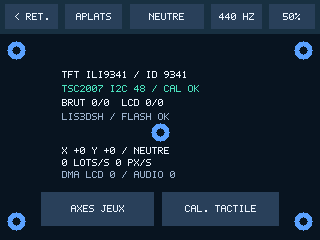
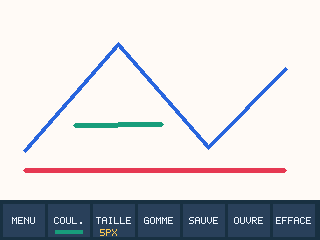
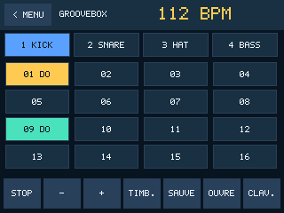
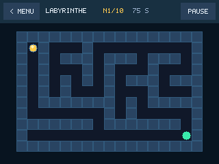
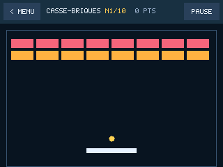
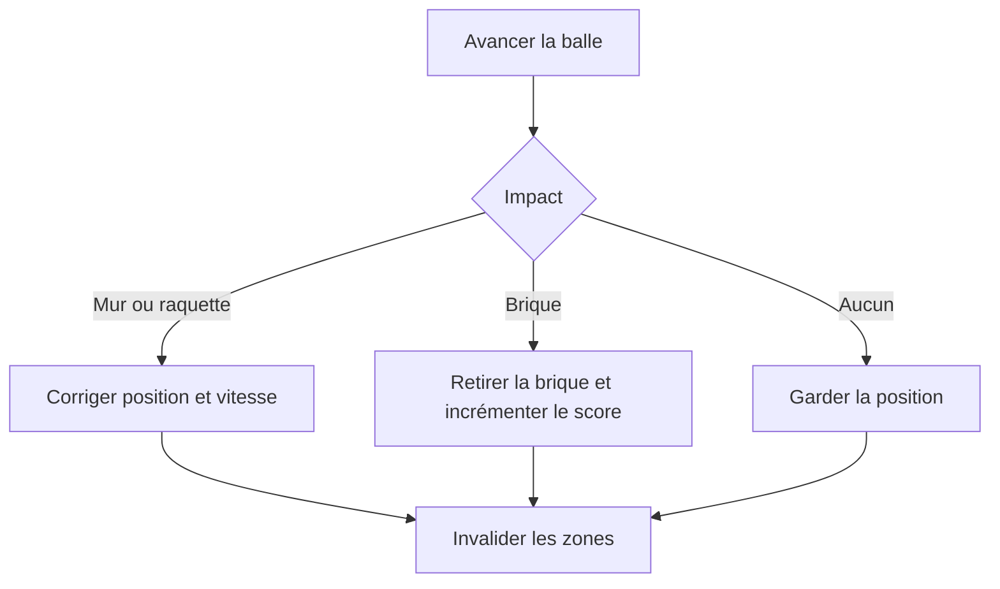
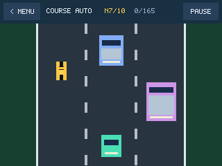

# Ateliers guidés

Les captures ont été produites sur PC par `app_render()`. Les données d’identification, la fréquence SPI et le débit réel se relèvent sur la carte. Le dossier de recette contient les champs à compléter.

## 1. Comprendre le diagnostic · 20 min

**Objectif.** Distinguer la liaison SPI qui dessine les pixels de la liaison I²C qui lit le doigt.

Depuis le menu, ouvrir **Paramètres → Diagnostic** au doigt. Avec **Aplats**, faire défiler les quatre couleurs puis revenir aux cinq cibles. Relever séparément l’identifiant du TFT et le nom du tactile. Avec un 1651, effectuer d’abord le calibrage s’il est demandé. Toucher la cible en haut à gauche. Comparer `BRUT` et `LCD`, puis répéter à droite et en bas. Retrouver la transformation dans `input.c` pour le 1947 ou dans `calibration.c` pour le 1651.

**Autoévaluation.** Expliquer pourquoi une dalle correctement colorée peut avoir un tactile absent. Identifier SCK et MOSI pour l’affichage, puis SCL et SDA pour le tactile I²C. Retrouver la conversion portrait vers paysage et expliquer pourquoi six mesures stables et un relâchement sont demandés pour chaque cible résistive.

Pour l’ancien 1651, observer à l’analyseur logique la sélection D8, puis comparer les fréquences SPI des phases tactile et TFT. Pour le 1651 actuel, interpréter les deux octets de conversion après une commande I²C. Expliquer le rôle du quatrième point dans la validation du calibrage.

## 2. Dessiner, enregistrer et relire · 30 min

**Objectif.** Relier un geste au canevas indexé, au transfert SPI et à la flash.

Ouvrir **Paint** et tracer un trait long entre deux angles. Choisir 1 px puis 19 px dans **Taille**. Dans **Coul.**, sélectionner une case, toucher **RVB**, régler une nuance et l’appliquer. Ajouter une autre forme puis utiliser la gomme. Enregistrer en **Dessin 1**. Effacer le canevas et réaliser un motif différent dans **Dessin 2**. Redémarrer, ouvrir les deux dessins successivement et comparer leur contenu. Observer le bandeau lors de la sauvegarde et relever la durée dans `obcp_live.last_flash_ms`.

Dans `paint.c`, la fonction `plot()` choisit l’octet puis le demi-octet associé à l’abscisse. `paint_segment()` relie deux positions tactiles par une suite de pixels entiers et renvoie l’emprise à redessiner. `paint_draw()` applique la palette seulement aux pixels de la bande demandée.

**Autoévaluation.** Calculer l’offset du pixel `(11, 3)`, identifier son demi-octet et expliquer pourquoi la gomme réécrit un index. Expliquer ce que préserve la copie A lors de l’écriture de B. Modifier la couleur d’une case déjà utilisée et décrire l’effet sur les traits existants. Retrouver les 36 octets de métadonnées de `PaintImage`.

## 3. Programmer une boucle musicale · 40 min

**Objectif.** Relier tempo, pas, échantillons et rapport cyclique.

Après validation de [l’interface audio](MATERIEL.md), ouvrir **Groovebox**. Choisir la piste 1 et activer les pas 1, 5, 9 et 13. Les cases allumées produisent un événement lors du passage du curseur. Choisir une autre piste et changer son timbre avec **Timb.**. Ouvrir **Clav.**, jouer une note, revenir aux pas et saisir cette hauteur sur une piste configurée en basse. Régler 120 BPM avec **+** ou **−**, jouer la boucle, puis sauvegarder et rouvrir un motif.

À 120 BPM, un temps dure 500 ms et les 16 pas forment une mesure de 2 s. Dans `audio.c`, le moteur déclenche les voix sur le pas courant et produit un bloc d’échantillons. Le tableau audio n’enregistre que des motifs, avec leurs hauteurs, leurs timbres et leur tempo.

**Autoévaluation.** Calculer la durée d’un pas à 100 BPM et le nombre moyen d’échantillons correspondants. Identifier où le code décide d’incrémenter le pas et où le DMA envoie un rapport cyclique au timer.

## 4. Piloter la bille · 30 min

**Objectif.** Comprendre la chaîne mesure, filtrage, simulation et rendu.

Dans **Paramètres → Axes jeux**, poser l’ObCP à plat, lancer **Mesurer** et suivre les inclinaisons droite et bas. Vérifier le mouvement du point et enregistrer. Dans **Labyrinthe**, incliner progressivement sur chaque axe. Observer l’inertie, un choc perpendiculaire et un glissement le long d’un mur. Mettre en pause, vérifier que le temps restant se fige, reprendre puis rejoindre la pastille verte. Passer au niveau suivant et comparer le nouveau parcours et le temps alloué.

Le module calcule la vitesse en pixels par seconde à partir de l’inclinaison. En multipliant par 20 ms, il obtient un déplacement en pixels. Chaque axe fait l’objet d’un test de collision. L’autre axe peut continuer à évoluer le long du mur.

**Autoévaluation.** Calculer le déplacement maximal par pas lorsque la vitesse d’un axe est limitée à 100 px/s. Expliquer le rôle de l’ancienne position de la bille dans le rendu. Avec une composante brute Y positive quand on baisse le bord droit et X négative quand on baisse le bord du bas, retrouver les bits produits par `tilt_guide_sample()`.

## 5. Étudier un rebond · 30 min

**Objectif.** Comprendre l’échantillonnage d’une trajectoire et les sous-pas.

Dans **Paramètres → Réactivité**, comparer X à 1 puis à 10. Dans **Casse-briques**, faire rebondir la balle au centre puis sur un bord de la raquette. Observer la variation de la composante horizontale et le score lors de la disparition d’une brique. Provoquer une défaite puis toucher **Rejouer**. Lors de la défaite suivante, toucher **Menu principal**. Repérer la boucle de trois sous-pas dans `breakout_step()` et comparer la largeur des raquettes et le nombre de briques dans le tableau `levels`.

**Autoévaluation.** Dire dans quel cas un grand pas peut sauter une brique. Identifier quelles zones doivent être redessinées lors d’un impact.

## 6. Mesurer le défilement · 25 min

**Objectif.** Produire un effet de mouvement en envoyant peu de pixels.

Dans **Course auto**, conduire au centre, dévier pour éviter les véhicules, puis provoquer une collision. Rejouer et atteindre 50 dépassements. Choisir **Niveau suivant** et observer la fréquence d’arrivée des véhicules. Relever `obcp_live.pixels_per_second` et `obcp_live.frames_per_second` en mode Debug sur une séquence jouée.

La chaussée et ses bords sont fixes. Les marquages déplacés et les véhicules invalident leurs anciennes et nouvelles positions. Le rendu recompose les deux positions à partir de la scène courante.

**Autoévaluation.** Avec 8 Mbit/s, estimer le débit en pixels RGB565 hors commandes. Calculer combien de pixels on peut envoyer en 40 ms, puis comparer ce budget à la mesure.
