# Jeux, réglages et dessin en version 0.4.0

Cette version reprend le fonctionnement validé sur l’ObCP en v0.3.0. Elle ajoute dix niveaux par jeu, une commande de raquette par position, la réactivité X/Y et une palette propre à chaque dessin. Les captures de ce guide sont produites par le code du firmware exécuté sur PC.

## L’accueil et le menu

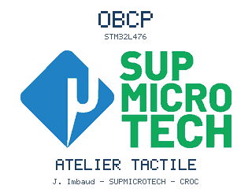

L’accueil dure environ 3,2 s. La boucle continue d’échantillonner les capteurs pendant son affichage. Ensuite, elle ouvre le menu ou le calibrage résistif demandé au démarrage. Le logo CMJN est converti vers sRGB avec son profil ICC, puis quantifié en RGB565. Sa ressource est compressée par lignes dans la flash du programme.

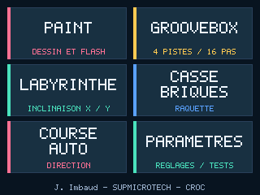

Chaque bouton mesure 147 × 64 px. Les titres utilisent tous la même police 5 × 7 agrandie deux fois. Les intitulés longs occupent deux lignes. La mention des shields se trouve dans **Paramètres**. La signature centrée du menu est **J. Imbaud - SUPMICROTECH - CROC**.

## Régler X et Y

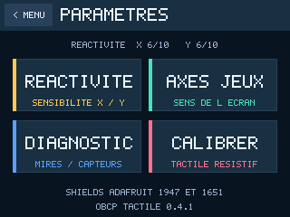

**Axes jeux** choisit le sens du mouvement et une éventuelle permutation X/Y. **Réactivité** choisit l’amplitude et la rapidité de la commande. **Diagnostic → Neutre** mesure la pose de repos. Ces trois réglages répondent à des besoins distincts.

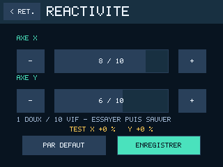

Dans **Réactivité**, toucher les barres ou les boutons **−** et **+**. Le réglage est appliqué immédiatement. Incliner la carte et observer **Test X/Y**, puis toucher **Enregistrer** pour le retrouver au prochain démarrage. **Par défaut** remet les deux axes à 6/10.

| Réactivité | Gain après la zone morte | Coefficient de filtre à 100 Hz |
| --- | --- | --- |
| 1 | 0,8 | 0,10 |
| 6, valeur initiale | 1,8 | 0,50 |
| 10 | 2,6 | 0,82 |

Le filtre calcule `mesure_filtree += alpha * (mesure - mesure_filtree)`. Un grand coefficient suit plus vite une variation. Le gain augmente ensuite la commande, bornée entre −1 et +1. La zone morte autour du neutre reste de 0,045 g avant ce gain. Le code applique les réglages dans le repère de l’écran, même lorsque les axes bruts du capteur ont été permutés.

Le casse-briques et la course utilisent X. Le labyrinthe utilise X et Y. Pour tester la raquette, commencer au réglage 6 puis essayer 8 ou 10. Les valeurs sont mémorisées dans un objet flash A/B séparé de l’orientation.

## Le parcours d’une partie

Chaque jeu commence au niveau 1. **Niveau suivant** poursuit la série après une victoire. **Rejouer** recommence le niveau courant après une défaite. Le dernier écran propose **Recommencer** pour revenir au niveau 1. Une nouvelle ouverture depuis le menu commence aussi au niveau 1.

**Menu principal** est accessible depuis les écrans de préparation, pause, victoire et défaite. Le bouton **< Menu** du bandeau reste disponible en partie. Dans la course, la collision produit d’abord un éclat d’environ 0,9 s, puis les boutons de fin apparaissent.

## Les dix labyrinthes

Les cartes sont fixes et différentes. La difficulté combine davantage de chemin et un temps plus court. Un déplacement de la colonne ci-dessous correspond à une case de 16 px le long du plus court chemin. La bille garde une inertie et peut glisser le long des murs. La pause arrête aussi le chronomètre.

| Niveau | Déplacements au plus court | Temps disponible |
| --- | --- | --- |
| 1 | 22 | 75 s |
| 2 | 26 | 68 s |
| 3 | 30 | 62 s |
| 4 | 34 | 56 s |
| 5 | 38 | 50 s |
| 6 | 46 | 44 s |
| 7 | 54 | 38 s |
| 8 | 62 | 32 s |
| 9 | 70 | 27 s |
| 10 | 74 | 23 s |

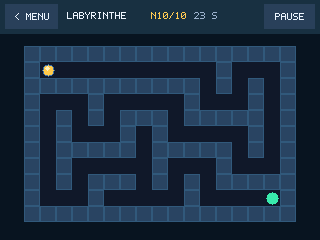

Les tests cherchent un chemin sur chaque carte. Un contrôle numérique sur le modèle physique a aussi atteint le dernier objectif en environ 17,1 s. La difficulté ressentie à la main reste à qualifier sur la carte.

## Les dix niveaux de casse-briques

La raquette suit une position liée à l’inclinaison. Une commande X de zéro la vise au centre. Les valeurs −1 et +1 visent les deux bords autorisés. À chaque pas de 20 ms, elle rejoint 75 % de la distance restante. Ce changement permet d’atteindre rapidement le côté désiré. Le réglage de réactivité agit sur la commande avant ce calcul.

Une brique renforcée, repérée par un cadre clair, demande deux impacts. Le premier enlève son renfort et rapporte 5 points. La destruction rapporte ensuite 10 points. Les trois sous-pas par calcul de trajectoire sont conservés pour tester les collisions de la balle rapide.

| Niveau | Briques | Dont renforcées | Largeur de raquette | Vitesse verticale initiale |
| --- | --- | --- | --- | --- |
| 1 | 16 | 0 | 72 px | 135 px/s |
| 2 | 20 | 0 | 68 px | 150 px/s |
| 3 | 24 | 0 | 64 px | 170 px/s |
| 4 | 28 | 0 | 60 px | 190 px/s |
| 5 | 32 | 0 | 56 px | 210 px/s |
| 6 | 32 | 8 | 50 px | 235 px/s |
| 7 | 32 | 16 | 44 px | 260 px/s |
| 8 | 32 | 24 | 38 px | 290 px/s |
| 9 | 32 | 32 | 32 px | 325 px/s |
| 10 | 32 | 32 | 26 px | 360 px/s |

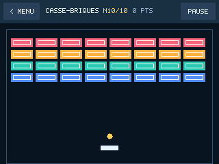

## Les dix niveaux de course

Le premier niveau demande 50 dépassements. Le score augmente lorsqu’un adversaire quitte le bas de l’écran. Les motos arrivent à partir du niveau 3, les fourgonnettes du niveau 5 et les camions du niveau 7. Leurs emprises de collision suivent leurs dimensions graphiques.

| Niveau | Objectif | Intervalle d’apparition | Vitesse verticale du trafic | Véhicules disponibles |
| --- | --- | --- | --- | --- |
| 1 | 50 | 1 100 ms | 120 px/s | Voitures |
| 2 | 60 | 1 000 ms | 132,5 px/s | Voitures |
| 3 | 75 | 900 ms | 145 px/s | Voitures, motos |
| 4 | 90 | 800 ms | 157,5 px/s | Voitures, motos |
| 5 | 110 | 720 ms | 170 px/s | Voitures, motos, fourgonnettes |
| 6 | 135 | 640 ms | 185 px/s | Voitures, motos, fourgonnettes |
| 7 | 165 | 560 ms | 200 px/s | Voitures, motos, fourgonnettes, camions |
| 8 | 200 | 480 ms | 220 px/s | Les quatre types |
| 9 | 240 | 420 ms | 240 px/s | Les quatre types |
| 10 | 300 | 360 ms | 260 px/s | Les quatre types |

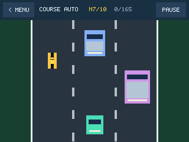

Un seul véhicule apparaît à chaque échéance. Leurs vitesses communes et leur espacement permettent de garder un passage. Au niveau 10, 360 ms correspondent à 93,6 px de déplacement, plus que la somme des hauteurs du camion et du joueur, soit 88 px. La direction peut atteindre 300 px/s à commande maximale.

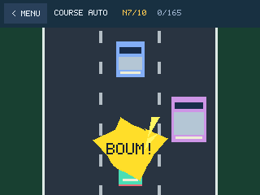

L’éclat est composé de disques, de triangles jaunes et d’un texte contrasté. Il change de teinte pendant 0,9 s. Le moteur continue de traiter les entrées et les transferts écran durant ce délai.

## Choisir la taille du crayon

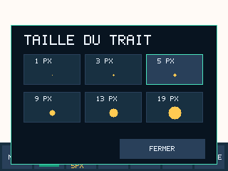

Dans Paint, **Taille** propose 1, 3, 5, 9, 13 ou 19 px. La valeur choisie s’affiche sous le bouton. Le crayon et la gomme utilisent le diamètre sélectionné. Le trait relie deux mesures tactiles par l’algorithme de Bresenham et dépose un disque à chaque position. Chaque disque est limité au canevas de 320 × 200 px.

## Définir une couleur RVB

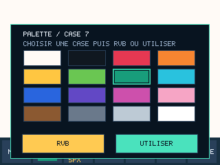

1. Toucher **Coul.**, puis la case à utiliser.
2. Toucher **RVB** pour éditer cette case.
3. Régler le rouge, le vert et le bleu avec les barres. Les boutons **−** et **+** ajustent une unité sur l’intervalle 0 à 255.
4. Toucher **Appliquer**, puis dessiner. **Annuler** quitte l’éditeur RVB en gardant la couleur précédente.
5. Utiliser **Sauve** et choisir un des deux dessins pour conserver le canevas et sa palette.

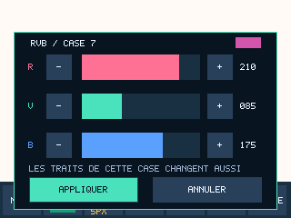

Le canevas conserve un indice de quatre bits par pixel, soit seize couleurs simultanées. Modifier une case recolore tous les traits qui utilisent son indice. Pour garder deux nuances différentes, affecter la nouvelle couleur à une autre case. La première case est aussi la couleur du fond et de la gomme.

Les composantes saisies sont converties en RGB565, avec cinq bits pour le rouge, six pour le vert et cinq pour le bleu. Au prochain chargement, certaines valeurs RVB affichées peuvent donc être arrondies. Cette représentation est aussi celle du TFT.

## Sauvegardes et mise à jour

La v0.4.0 lit les anciens dessins avec leur palette d’origine. Lors de leur prochaine sauvegarde, elle ajoute une signature, un numéro de format, le diamètre et les seize couleurs. Le dessin passe de 32 000 à 32 036 octets et tient dans chacune des copies flash existantes.

Le choix de la copie inactive tient compte des deux formats. Une interruption pendant le premier enregistrement enrichi laisse donc la copie ancienne exploitable. Les essais PC injectent huit coupures à différentes phases de cette migration. Les firmwares précédents connaissent le format de dessin de 32 000 octets.

Pour passer de la v0.3.0 à cette version, programmer le HEX Release avec un effacement limité aux pages du programme en banque 1. Les données sont en banque 2. Les deux pages de réactivité précèdent les anciennes zones. La migration sur image flash produite par le code v0.3.0 vérifie aussi les motifs, le tactile et les axes. [Adresses et méthode A/B](ARCHITECTURE.md#la-mémoire-de-sauvegarde)

## Lire et modifier le programme

| Fonction ou donnée | Point à étudier |
| --- | --- |
| `menu_card()`, `card()`, `draw_menu()` | Zones tactiles et dessin des six boutons uniformes. |
| `app_start_splash()`, `app_step()` | Durée de l’accueil dans la boucle coopérative. |
| `tilt_sample()`, `tilt_project()` | Filtrage, gain X/Y, zone morte et changement de repère. |
| Tableaux `levels` des jeux | Objectifs, vitesses et tailles de chaque niveau. |
| `breakout_step()` | Cible de position et suivi de la raquette. |
| `rival_box()`, `draw_vehicle()`, `draw_crash()` | Dimensions des véhicules et éclat de collision. |
| `PaintImage`, `paint_save()`, `paint_load()` | Pixels indexés, palette et compatibilité de format. |
| `storage_read_sized()`, `active_copy()` | Sélection de la dernière copie valide malgré une longueur différente. |
| `Tools/import_logo.py` | Conversion du logo, profil ICC et compression de la ressource. |

Pour régénérer la ressource graphique après une modification du fichier source, installer Pillow sur le PC puis lancer `python Tools/import_logo.py` depuis le dossier du projet. La compilation du firmware utilise directement `Core/Src/obcp/logo.c`.
