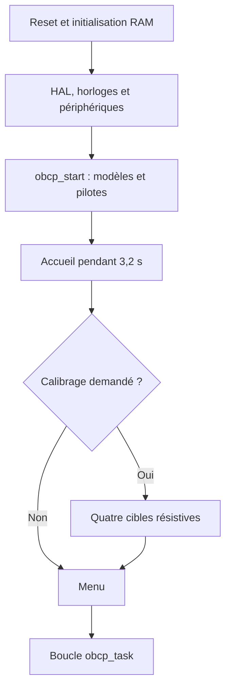
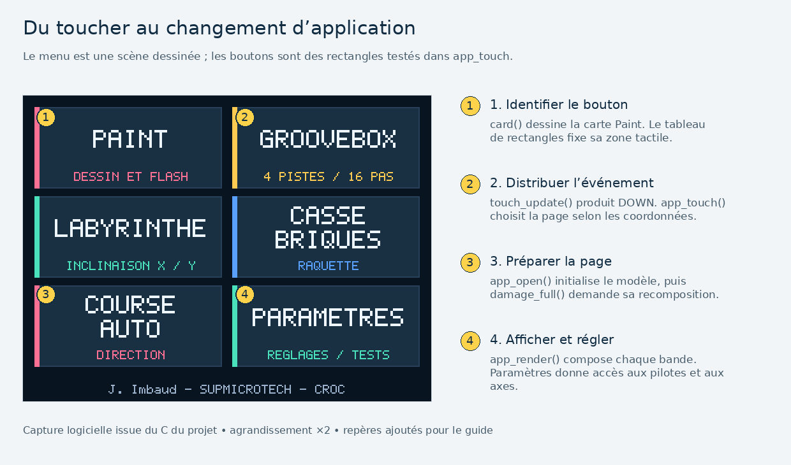
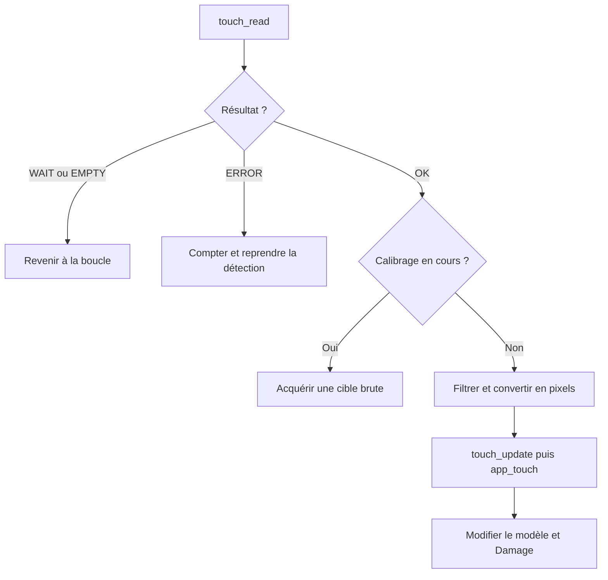
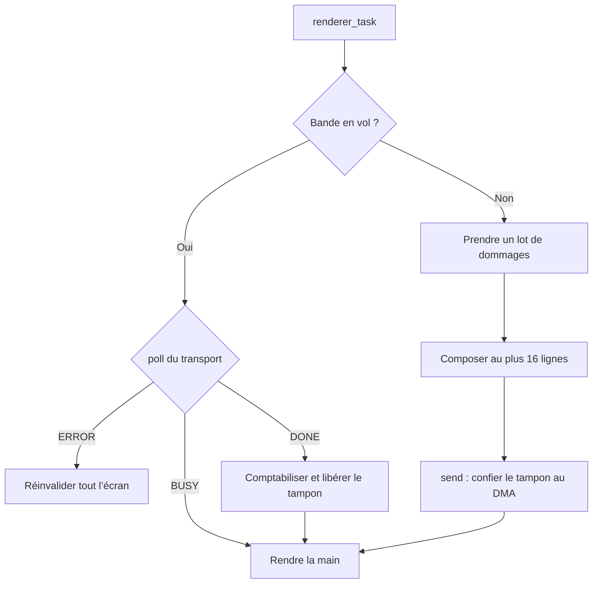
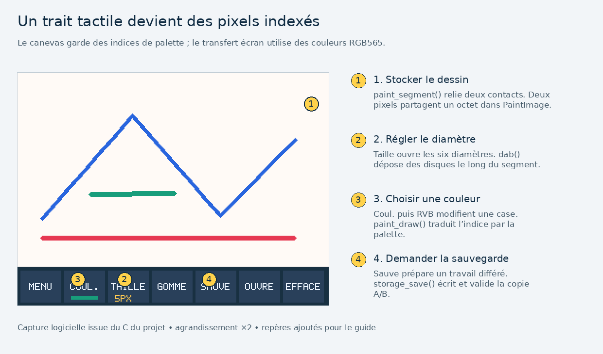
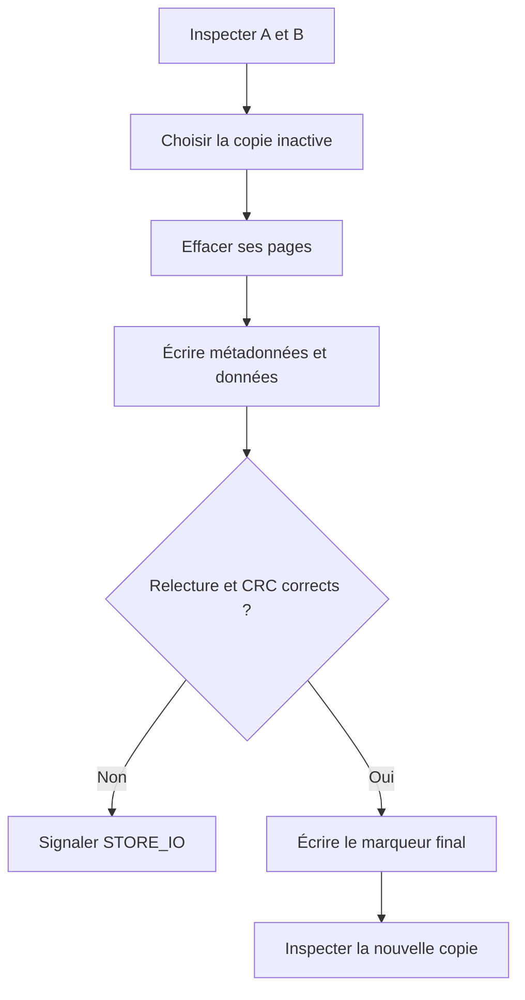

# S’approprier le programme, pas à pas

Ce parcours part du fonctionnement visible, suit les données dans le code et propose de petites modifications. Il demande environ trois heures, réparties en séquences de 20 à 40 minutes. Les fichiers C sont encodés en UTF-8. Les textes affichés par la petite police du TFT utilisent les caractères disponibles dans cette police.

## 1. Les quatre objets à reconnaître

| Objet | Ce qu’il possède | Durée de vie | Lieu de définition |
| --- | --- | --- | --- |
| `App` | Page ouverte, modèles du dessin, des jeux et de l’audio, réglages et demandes de sauvegarde | Toute l’exécution | [obcp_app.h](../Core/Inc/obcp_app.h), instance statique dans [board.c](../Core/Src/obcp/board.c) |
| `Damage` | Rectangles dont l’image est à recalculer | Deux listes se relaient, attente et lot courant | [obcp_gfx.h](../Core/Inc/obcp_gfx.h) |
| `Renderer` | Tampon de 16 lignes, lot et transfert en cours | Toute l’exécution | [obcp_gfx.h](../Core/Inc/obcp_gfx.h), logique dans [gfx.c](../Core/Src/obcp/gfx.c) |
| `Storage` | Contexte et trois pointeurs de fonctions pour lire, effacer et programmer | Port choisi au démarrage | [obcp_storage.h](../Core/Inc/obcp_storage.h) |

Une structure C regroupe des champs. `app.screen` désigne un champ d’une variable, alors que `a->screen` désigne le même champ à travers un pointeur. `&app` est l’adresse de la variable. Une fonction recevant `App *a` peut donc modifier cette instance.

`static App app;` au niveau du fichier crée un objet qui subsiste entre les appels, accessible par son nom uniquement dans ce fichier. Il ne se trouve pas sur la pile d’une fonction. L’initialisation à zéro des objets statiques sans initialiseur est assurée avant `main`.

`const App *a` permet de lire l’objet à travers ce pointeur, sans le modifier par ce chemin d’accès. C’est la forme utilisée pour dessiner une scène. Le moteur graphique doit lire un état cohérent, sans faire avancer les jeux à chaque bande.

## 2. Comprendre le démarrage

Ouvrir [main.c](../Core/Src/main.c), puis [board.c](../Core/Src/obcp/board.c). Dans le premier fichier, les ajouts pédagogiques et les appels applicatifs se trouvent entre les marqueurs `USER CODE`. CubeMX conserve ces blocs lors d’une régénération avec l’option correspondante activée.

`Reset_Handler`, fourni dans [le fichier de démarrage](../Core/Startup/startup_stm32l476rgtx.s), prépare notamment la RAM avant `main`. `HAL_Init` initialise la HAL et sa base de temps. `SystemClock_Config` porte le système à 64 MHz. Les fonctions `MX_..._Init` configurent les broches et périphériques. Elles n’exécutent aucune partie du jeu.

`obcp_start` initialise les modèles, branche le port flash, relit les objets persistants, prépare l’ILI9341, reconnaît le tactile et l’accéléromètre, puis présente l’accueil. Un contrôleur résistif sans profil valide conduit ensuite au calibrage.

L’accueil est un état de l’application. Sa durée est suivie par les pas de simulation. La boucle continue donc à traiter les entrées et le rendu pendant cette page.

**Manipulation.** Poser un point d’arrêt sur `obcp_start`, puis sur `obcp_task`. Le premier est atteint une fois au reset. Le second est atteint continuellement. Examiner `app.screen` dans le débogueur de `board.c`.

## 3. Un tour de boucle et ses échéances

`obcp_task` commence par l’audio, puis les entrées. Il avance les jeux au pas fixe, actualise les mesures, sert le rendu et traite un éventuel travail flash. Les tâches rendent la main après un travail borné. Ce partage est dit coopératif.

| Service | Échéance ou déclenchement | Unité et limite |
| --- | --- | --- |
| Audio | Une moitié DMA vient d’être consommée | 256 échantillons, soit 16,384 ms |
| Tactile | Nouveau départ visé toutes les 10 ms, étapes poursuivies entre les départs | Une observation peut demander plusieurs tours |
| Accéléromètre | Toutes les 10 ms environ | ODR matériel 100 Hz |
| Simulation | Pas fixe de 20 ms | Au plus quatre pas de rattrapage par tour |
| Diagnostic visible | Toutes les 160 ms environ | Seulement les zones concernées sont invalidées |
| Débits | Fenêtre d’au moins 1 s | Lots terminés/s et pixels/s |
| Flash | Demande explicite, après affichage du message ou attente de 450 ms | Opération synchrone, audio arrêté pendant l’écriture |

`uint32_t now = HAL_GetTick();` donne un tick en millisecondes. Le test `now - last_sample >= 10U` mesure une durée avec une soustraction non signée. Cette manière de faire tolère le rebouclage du compteur, pour les petits intervalles utilisés ici. Comparer directement `now >= last_sample + 10U` demande davantage d’attention au débordement.

Le pas physique reste de 20 ms même si le processeur exécute plusieurs tours très vite. Quatre rattrapages au maximum évitent une accumulation sans fin après un retard. Après une écriture flash, la base de temps du jeu est recadrée.

**Manipulation.** Dans `obcp_live`, surveiller `audio_missed`, `lcd_errors`, `frames_per_second` et `pixels_per_second`. Le premier compteur signale une échéance audio manquée. Les lots/s ne mesurent pas nécessairement les images/s d’une scène immobile.

## 4. Suivre un toucher jusqu’au menu

Lire dans cet ordre `touch_read`, `sample_touch`, `touch_update`, `app_touch`, `app_open`, `app_render`.

1. La façade tactile appelle le pilote choisi au démarrage. Il produit une observation `RawTouch`.
2. `sample_touch` distingue une observation complète, une attente, une FIFO sans nouveau point et une erreur.
3. Le contact résistif est stabilisé. Un profil affine convertit ses valeurs ADC en pixels. Le capacitif utilise une rotation du repère portrait.
4. `touch_update` compare le contact à son état précédent. Un nouvel appui produit `TOUCH_DOWN`, un déplacement `TOUCH_MOVE`, une disparition `TOUCH_UP`.
5. `app_touch` examine la page et les rectangles tactiles. Un appui dans Paint appelle `app_open` avec `SCREEN_PAINT`.
6. L’ouverture initialise le modèle concerné et invalide la scène. Le moteur graphique enverra les pixels lors de ses prochains appels.

`WAIT` n’est pas un relâchement. Sur TSC2007, il laisse passer du temps entre commande et lecture ADC. `EMPTY` conserve le dernier contact lorsque la FIFO STMPE610 n’a pas de nouveau point. Confondre ces résultats créerait des coupures dans les traits.

Les rectangles contiennent leur bord gauche et supérieur, mais excluent leurs bords droit et inférieur. Ainsi, deux boutons adjacents ne partagent aucun pixel de frontière.

**Manipulation.** Mettre un point d’arrêt dans `app_touch`, toucher Paint et observer `event.kind`, `event.x`, `event.y`. Reprendre ensuite l’exécution pour laisser le DMA et les temporisations fonctionner normalement.

## 5. Comprendre le dessin par bandes

Un écran complet RGB565 demanderait `320 × 240 × 2 = 153 600` octets. Le moteur garde seulement `320 × 16 × 2 = 10 240` octets. `Gfx` décrit la bande courante et sa position dans le repère de l’écran.

`gfx_pixel` intersecte la coordonnée avec `g->clip`, calcule l’offset dans cette bande puis écrit l’octet fort et l’octet faible de la couleur. Le TFT reçoit les composantes dans cet ordre. Le format RGB565 réserve 5 bits au rouge, 6 au vert et 5 au bleu.

`Damage` demande une recomposition, sans dessiner immédiatement. Pour déplacer une voiture, le modèle ajoute son ancien rectangle et son nouveau rectangle. L’ancienne région est donc effacée par le fond lors du rendu, et la nouvelle région reçoit la voiture.

Les zones proches sont fusionnées si l’enveloppe coûte peu de pixels supplémentaires. Quand 28 rectangles ne suffisent plus, le moteur demande un écran complet.

Le CPU ne doit pas réécrire le tampon pendant le transfert. Le contrat du transport, documenté dans `DisplayPort`, associe `send` au début du transfert et `poll` à son suivi. Cette séparation permet au test PC de remplacer le SPI par une image en RAM.

**Manipulation.** Lire `test_display` puis `render_and_check` dans [le banc PC](../Tests/test_obcp.c). La comparaison pixel par pixel vérifie que le découpage en bandes donne le même résultat que la recomposition complète.

## 6. Exemple complet avec Paint

Le dessin de 320 × 200 pixels utilise seize indices de palette. Chaque indice tient sur 4 bits. Deux pixels partagent donc un octet, soit 32 000 octets pour le canevas.

Pour le pixel `(x,y)`, `paint_get` calcule l’octet `(y * 320 + x) / 2`. Un X pair utilise les bits 0 à 3, un X impair les bits 4 à 7. `plot` efface seulement le demi-octet voulu et conserve son voisin avec un masque.

`paint_segment` applique l’algorithme de Bresenham entre deux contacts. L’erreur cumulée détermine les pas entiers sur X et Y. À chaque position, `dab` dépose un disque correspondant au diamètre choisi. Le rectangle de dommage couvre les deux extrémités et l’épaisseur du trait.

`paint_draw` transforme ensuite chaque indice en RGB565 à l’aide de la palette du dessin. Modifier une case de palette recolore tous les pixels portant cet indice. La gomme écrit l’indice zéro, qui correspond au fond.

La sauvegarde ajoute 36 octets de métadonnées aux pixels, pour une charge utile de 32 036 octets. Le lecteur reconnaît aussi l’ancien format de 32 000 octets. Il ne faut pas enregistrer directement `sizeof(Paint)`, car cette structure contient aussi l’état transitoire du crayon.

**Manipulation.** Tracer avec une case de palette puis modifier sa valeur RVB. Vérifier que les anciens traits changent aussi. Sauvegarder, redémarrer et comparer la palette relue.

## 7. De l’accélération à la commande de jeu

[accelerometer.c](../Core/Src/obcp/accelerometer.c) convertit les registres du LIS3DH ou LIS3DSH en g. [input.c](../Core/Src/obcp/input.c) construit ensuite une commande commune aux trois jeux.

Les 32 premières mesures valides servent à acquérir le neutre. Le filtre travaille sur les composantes recentrées. La permutation et les signes les projettent dans le repère écran, avec X positif vers la droite et Y positif vers le bas. Une zone morte de 0,045 g donne zéro près du repos. La réactivité règle à la fois le lissage et le gain par axe, avant saturation entre −1 et +1.

`tilt_sample` rejette une mesure indisponible et les normes d’accélération hors de la plage admise. Il faut distinguer `calibrated`, qui indique la présence d’un neutre, de `valid`, qui indique une mesure exploitable.

Dans le labyrinthe, les commandes produisent une accélération, puis une vitesse amortie et une position. Les murs sont testés avec la distance entre un disque et un rectangle. Le casse-briques transforme X en position cible de raquette, rejoint 75 % de l’écart par pas et calcule trois sous-pas de balle. La course transforme X en déplacement latéral ; les adversaires ont des dimensions propres à leur type.

Chaque jeu contient dix niveaux indexés de 0 à 9 dans le code, affichés de 1 à 10. `GamePhase` distingue attente, partie, pause, victoire et défaite. Les paramètres de difficulté sont constants en flash. Le fichier [JEUX_ET_DESSIN.md](JEUX_ET_DESSIN.md) détaille leur progression.

**Manipulation.** Lire `breakout_step` et calculer l’écart restant après deux pas si la cible est fixe. Il reste `0,25² = 6,25 %` de l’écart initial, hors filtre d’entrée.

## 8. Comprendre la musique

Le moteur `audio.c` produit des comparaisons PWM sur 10 bits à 15 625 échantillons/s. `pwm_audio.c` assure leur transport vers TIM1. Le modèle musical ne connaît pas les broches de la carte.

La synthèse DDS utilise une phase non signée de 32 bits. Ajouter `fréquence × 2^32 / 15625` à chaque échantillon parcourt une période à la fréquence voulue. Le débordement non signé est le rebouclage normal de l’oscillateur. Les bits de poids fort alimentent une onde triangulaire.

Les percussions utilisent aussi un registre à décalage pseudo-aléatoire, le LFSR. Une attaque et une décroissance limitent les discontinuités. Les voix sont mélangées, le volume est appliqué puis le résultat est borné autour de 512.

Les quatre pistes possèdent chacune une voix. Une cinquième voix sert au clavier. Le séquenceur comporte seize pas. À chaque échantillon, il ajoute `4 × BPM` à un accumulateur. Au seuil `60 × 15625`, il avance d’un pas. À 120 BPM, un pas dure 125 ms.

Le transport utilise un anneau de 512 valeurs. L’IRQ signale une moitié consommée en incrémentant `epoch`. La boucle calcule la prochaine moitié dans `staging`, puis vérifie que le DMA lit toujours l’autre moitié avant de copier. `volatile` rend visibles les accès à l’indicateur partagé ; la vérification de l’époque et du compteur DMA assure ici le protocole de propriété.

**Manipulation.** Dans `test_audio`, repérer le comptage des passages montants sur une seconde. Ce test vérifie la fréquence numérique ; l’écoute et le filtre analogique se valident sur la carte.

## 9. Comprendre la sauvegarde A/B

Le format logique est dans [storage.c](../Core/Src/obcp/storage.c). Les effacements HAL et l’ECC sont dans [flash_port.c](../Core/Src/obcp/flash_port.c). Le script de liaison protège le programme et définit la réserve.

Une sauvegarde sélectionne la dernière copie valide, efface l’autre emplacement, y programme les métadonnées et les données, contrôle la relecture, puis écrit le marqueur final. L’ancienne copie reste intacte pendant cette opération.

| Offset d’en-tête | Taille | Signification |
| --- | --- | --- |
| 0 | 4 octets | Signature du stockage |
| 4 | 4 octets | Version et identifiant d’objet |
| 8 | 4 octets | Longueur de la charge utile |
| 12 | 4 octets | Génération, comparée avec débordement |
| 16 | 4 octets | CRC32 des données |
| 20 | 4 octets | CRC32 des vingt premiers octets |
| 24 | 8 octets | Marqueur de validation programmé en dernier |

La flash STM32 se programme par double mot de huit octets alignés. Un double mot vierge est programmé une seule fois pendant une transaction. Un dernier bloc incomplet est complété avec `0xFF`. L’effacement concerne des pages complètes de 2 Kio.

Les formats sont encodés explicitement en octets little-endian. Enregistrer les octets d’une structure contenant des pointeurs ou des flottants rendrait le format dépendant du compilateur et de l’exécution.

**Manipulation.** Lire les trois fonctions `mem_read`, `mem_erase`, `mem_program` du banc PC, puis `test_storage`. L’indice `fail_at` injecte une coupure pendant une opération ; la relecture doit retrouver une copie valide.

## 10. Faire une première évolution

Choisir une modification courte et vérifier son effet avant d’enchaîner.

| Exercice | Fichier et point d’entrée | Résultat attendu | Vérification |
| --- | --- | --- | --- |
| Changer une couleur de menu | `app.c`, constantes RGB565 | Une carte change de teinte | Régénérer les captures PC |
| Comprendre un diamètre | `paint.c`, `PAINT_DIAMETERS` | Relier diamètre et rayon du disque | Tracer près des quatre bords |
| Ajuster une difficulté | `breakout.c`, table `levels` | Modifier un seul paramètre d’un niveau | Tests PC et partie réelle |
| Ajouter une mesure visible | `Diagnostics`, `board.c`, `draw_diag` | Acquisition séparée de l’affichage | Observer aussi `obcp_live` |
| Ajouter une application | `Screen`, `App`, `app_open`, `app_touch`, `app_step`, `app_render` | Modèle initialisé, commandes et retour menu | Navigation, rendu et tests adaptés |

Pour une nouvelle application, commencer par un modèle autonome sans HAL, avec `init`, `step` et `draw`. L’intégrer ensuite à `App`. Une commande modifie le modèle et déclare ses dommages. Le dessin lit le modèle. Le matériel reste accessible par une interface de pilote.

Après une modification de pinout ou de timer, modifier d’abord le `.ioc`, régénérer et suivre la [procédure CubeMX](../README.md#régénérer-avec-stm32cubemx-autonome). Une modification locale d’un bloc généré hors `USER CODE` sera remplacée par la génération.

## 11. Lire les composants fournis par ST

| Fichier ou dossier | Rôle dans ce projet | Où commencer |
| --- | --- | --- |
| `Core/Startup/*.s` | Vecteurs d’interruption, préparation du cœur et appel de `main` | `Reset_Handler` puis table des vecteurs |
| `Core/Src/system_stm32l4xx.c` | Initialisation système CMSIS et fréquence du cœur | `SystemInit`, `SystemCoreClockUpdate` |
| `Core/Src/syscalls.c` | Stubs des appels système de la bibliothèque C | `_write`, sans supposer une UART déjà branchée |
| `Core/Src/sysmem.c` | Support minimal du tas pour la bibliothèque C | `_sbrk`, bornes du linker |
| `Drivers/STM32L4xx_HAL_Driver` | Services HAL des périphériques | `HAL_SPI_Transmit_DMA`, `HAL_DMA_IRQHandler` |
| `Drivers/CMSIS` | Registres du cœur et du STM32 | Types de registres et masques nommés |

Ces composants conservent leurs commentaires et licences d’origine. Les ajouts du projet sont documentés dans leurs interfaces, dans les crochets CubeMX et dans le [guide des pilotes](PILOTES.md). Pour approfondir un registre, partir du manuel de référence du STM32 puis lire son accès dans la HAL.

## 12. Autoévaluation

À la fin de ce parcours, expliquer sans regarder le code comment un `TOUCH_DOWN` ouvre Paint, pourquoi un rectangle déplacé invalide deux zones, qui possède le tampon pendant le DMA et pourquoi le marqueur flash est écrit en dernier.

Retrouver ensuite dans les sources les unités d’un incrément de phase, d’une vitesse de balle, d’une mesure d’accélération et d’un offset flash. Si une réponse reste difficile, reprendre le contrat de la fonction concernée dans son en-tête, puis son traitement dans le fichier C.
