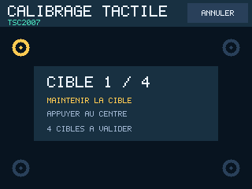
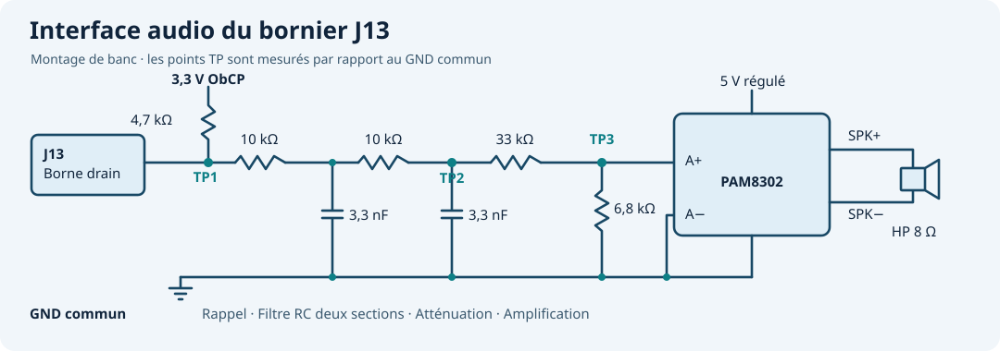

# Montage et première mise sous tension

Le firmware cible l’ObCP au STM32L476RG avec les shields **Adafruit 1947 et 1651**. L’ILI9341 utilise SPI1 dans les trois profils. Le connecteur R3 de l’ObCP fournit 5 V pour le shield et 3,3 V sur IOREF pour les niveaux logiques. Le fabricant annonce environ 100 mA pour l’ensemble écran et tactile. [Adafruit 1947](https://www.adafruit.com/product/1947) · [Adafruit 1651](https://www.adafruit.com/product/1651) · [Schéma ObCP](https://github.com/jimbaud/LAB_ObCP_L476_STM32CubeIDE/blob/cef4cdae9e7564ef920e2c2c74603c82b863f89c/Images/Schema_ObCP_V24_Page2.png)

| Shield | Tactile | Relevé attendu dans Diagnostic |
| --- | --- | --- |
| 1947 capacitif | FT62xx sur I²C, adresse `0x38` | `FT62XX I2C 38 / ID 06` pour le FT6206 |
| 1651 actuel | TSC2007 résistif sur I²C, adresse d’usine `0x48` | `TSC2007 I2C 48` et état du calibrage |
| 1651 ancien, par exemple CAO v2.2 | STMPE610 résistif sur SPI, sélection D8 | `STMPE610 SPI 0811` et état du calibrage |

Le 1651 actuel se reconnaît notamment au marquage TSC2007 et à son connecteur STEMMA QT. Les deux ponts d’adresse du TSC2007 restent dans leur état d’usine. Pour la première mise en route, réserver `0x38` et `0x48` au tactile et laisser le port STEMMA QT libre. [Guide TSC2007](https://learn.adafruit.com/adafruit-2-8-tft-touch-shield-v2/tsc2007-pinouts) · [Guide STMPE610](https://learn.adafruit.com/adafruit-2-8-tft-touch-shield-v2/stmpe-resistive-pinout)

## Identifier le routage du shield

Relever la révision hors tension, puis mesurer la continuité de SCK, MISO et MOSI vers D13, D12 et D11. Le 1651 TSC2007 est livré avec le SPI sur l’ICSP. Pour ce montage, ouvrir les trois ponts **ICSP**, fermer **13**, **SO** et **SI/11** puis vérifier à nouveau chaque liaison. Sur le 1947 et le 1651 ancien, appliquer le même principe en suivant les marquages de leur révision et le résultat du multimètre. Les ponts A4/A5, lorsqu’ils existent, restent ouverts pour utiliser SDA et SCL dédiées du R3. Le 1651 actuel utilise IOREF en configuration d’usine. [Ponts du 1651 TSC2007](https://learn.adafruit.com/adafruit-2-8-tft-touch-shield-v2/tsc2007-pinouts) · [CAO des trois variantes](https://github.com/adafruit/Adafruit-2.8-TFT-Shield-v2-PCB)

| Signal | Connecteur Arduino ou ObCP | STM32L476 | Réglage |
| --- | --- | --- | --- |
| SCK, MISO, MOSI | D13, D12, D11 | PA5, PA6, PA7 | SPI1, mode 0, 8 bits, 8 Mbit/s |
| TFT_CS, TFT_DC | D10, D9 | PB6, PC7 | GPIO, repos à 1 |
| SD_CS | D4 | PB5 | GPIO à 1, lecteur microSD désélectionné |
| Tactile SCL, SDA | SCL, SDA dédiées R3 | PB8, PB9 | I²C1, FT62xx à `0x38` ou TSC2007 à `0x48`, adresses sur 7 bits |
| TOUCH_SPI_CS | D8, J3 broche 1 | PA9 | STMPE610, sortie initialisée à 1. SPI1 à 1 MHz durant l’accès tactile |
| Alimentation et référence | 5 V, IOREF, GND | Rails de la carte | IOREF 3,3 V |
| Capteur de mouvement | U4, sélection PC5 | PC10, PC11, PC12 | SPI3 à 4 Mbit/s |
| Sortie PWM | J13 | PB1 | TIM1_CH3N, étage MOSFET embarqué |
| Bouton utilisateur | SW1 | PC13 | Entrée active à zéro. Raccourci de diagnostic si le montage laisse le bouton accessible. |
| LED d’état | D5 de l’ObCP | PC6, PC8 | Impulsion rouge 500 ms ou verte 300 ms au démarrage et à la fin d’une opération de stockage. |

## Distinguer l’écran et le tactile

1. Depuis le menu tactile, ouvrir **Paramètres → Diagnostic**. Les commandes restent accessibles avec le shield monté au-dessus de SW1.
2. Toucher quatre fois **Aplats**. Vérifier l’apparition du rouge, du vert, du bleu et du blanc sous le bandeau. Au cinquième appui, l’écran revient aux cibles. **< Ret.** revient aux paramètres.
3. Pour le 1651, suivre le calibrage s’il s’ouvre après l’accueil. **Paramètres → Calibrer** relance la procédure. Toucher chaque cible jaune et relâcher après son passage au vert. Le quatrième point doit se trouver à 14 pixels au plus de la position attendue sur chaque axe. Un écart plus grand relance la séquence.
4. Dans **Diagnostic**, toucher une fois le centre de chacune des cinq cibles. Elle devient verte si le contact est dans la zone attendue. Relever **BRUT** pour la position lue et **LCD** pour la position convertie en coordonnées écran.

Si un profil résistif erroné empêche d’ouvrir le diagnostic, appuyer sur la dalle avant le reset ou l’alimentation. Garder l’appui jusqu’à l’affichage du calibrage, environ 1,3 s après le début des acquisitions. Relâcher puis suivre les quatre cibles. Cette entrée de secours utilise les mesures brutes d’un contrôleur résistif reconnu.

| Observation | Lecture dans `obcp_live` | Vérification |
| --- | --- | --- |
| L’écran reste blanc à chaque appui | `diag_pattern` doit passer de 0 à 4, puis revenir à 0. `lcd_id` vaut normalement `0x9341`. | Vérifier les ponts SPI, SCK, MOSI, CS et D/C. Le registre d’identification est lu à 4 Mbit/s sur MISO. Le firmware tente d’écrire même si cette lecture est vide. |
| La mire apparaît, le tactile affiche **ABSENT** | `touch_ok` vaut 0. Le code reprend la détection toutes les 500 ms environ. | Pour I²C, vérifier IOREF, SDA/SCL et l’adresse attendue. Pour le STMPE610, mesurer D8 et SCK pendant le sondage. |
| La position est décalée ou inversée | Comparer `touch_raw_x/y` du dernier contact et `touch_x/y` de la dernière conversion valide. `touch_down` signale un contact converti en cours. | Pour le 1651, refaire le calibrage. Pour le 1947, vérifier `OBCP_TOUCH_FLIPPED` dans `Core/Inc/obcp_config.h` si l’écart correspond à un demi-tour. |
| La bille, la raquette ou la voiture part du mauvais côté | `tilt_axes` code l’échange X/Y dans le bit 0 et les inversions de X et Y dans les bits 1 et 2. | Ouvrir **Paramètres → Axes jeux** et vérifier le mouvement du point avant d’enregistrer. |
| Le tactile répond par intermittence | `touch_errors` compte les échecs. Après trois échecs consécutifs, le firmware reprend la détection. `touch_z1/z2` donnent les mesures de pression du TSC2007. | Contrôler les niveaux du bus. Sur le 1651 résistif, comparer les valeurs au repos et avec un appui stable. |

`lcd_io_ok` rapporte le statut de l’initialisation côté HAL. La lecture de l’identifiant et la mire visible donnent des informations distinctes sur les échanges avec l’écran. `touch_controller` vaut 0 pour absent, 1 pour FT62xx, 2 pour STMPE610 et 3 pour TSC2007. `touch_id` vaut zéro pour le TSC2007, qui répond à un protocole de conversion. `touch_calibrated` indique un calibrage résistif chargé ou réalisé en RAM. Après cinq cibles validées, `touch_hits` vaut `0x1F`.

| J17 | Raccordement SWD |
| --- | --- |
| 2 | SWCLK |
| 3 | GND |
| 4 | SWDIO |
| 5 | NRST |
| Référence sonde | 3,3 V de J6. La broche 1 de J17 correspond à VIN sur le schéma. |

## Audio · adaptation de J13

Le bornier J13 expose un +5 V et le drain d’un MOSFET qui commute la charge vers GND. Prélever le signal sur la borne **drain**. Relier les masses de la carte, du filtre et de l’ampli à un point GND commun. Le schéma ci-dessous est un **montage d’essai à qualifier à l’oscilloscope**.

| Élément | Valeur ou référence | Rôle |
| --- | --- | --- |
| Résistance de rappel | 4,7 kΩ vers le 3,3 V de l’ObCP | Recrée le niveau haut lorsque le MOSFET est ouvert. Courant maximal de rappel d’environ 0,70 mA. |
| Deux sections RC | R1 = R2 = 10 kΩ, C1 = C2 = 3,3 nF | Reconstituent le signal audio et atténuent la porteuse à 62,5 kHz. |
| Atténuateur d’entrée | R3 = 33 kΩ en série, R4 = 6,8 kΩ vers GND | Rapport à vide de 0,17 pour le diviseur seul. La charge et le filtre réduisent la valeur réelle. |
| Ampli analogique | Adafruit PAM8302 mono, réf. 2130, VIN à 5 V | A+ reçoit le signal atténué. A− rejoint GND. Le module comporte un réglage de gain et un couplage capacitif. |
| Haut-parleur | 8 Ω, au moins 1 W pour l’essai à volume modéré | Entre SPK+ et SPK− de l’ampli. |

Chaque section RC isolée aurait une fréquence de coupure de `1/(2πRC) ≈ 4,8 kHz`. Les deux sections se chargent mutuellement. Le gain et la bande passante réels se mesurent avec le drain et l’ampli raccordés. Pour la mise au point, alimenter l’ampli par un **5 V régulé séparé** et reprendre GND sur l’ObCP. À titre de budget, délivrer 1 W avec un rendement de 80 % demande environ 250 mA sous 5 V, en plus de la consommation de la carte et de l’écran.

Commencer avec le gain de l’ampli au minimum. Sur **Diagnostic**, activer **440 Hz**. Mesurer TP1 pour vérifier la porteuse, TP2 pour observer la reconstruction et TP3 pour ajuster le niveau d’entrée. Sur un oscilloscope à masse commune, mesurer les deux sorties de l’ampli avec deux sondes référencées à GND puis calculer leur différence. Comparer la fréquence et le niveau obtenu avec et sans activité du TFT. [Adafruit PAM8302](https://learn.adafruit.com/adafruit-pam8302-mono-2-5w-class-d-audio-amplifier/pinouts) · [Note ST sur l’audio PWM](https://www.st.com/resource/en/application_note/an2394-str7str9-audio-generation-with-pwm-stmicroelectronics.pdf)
