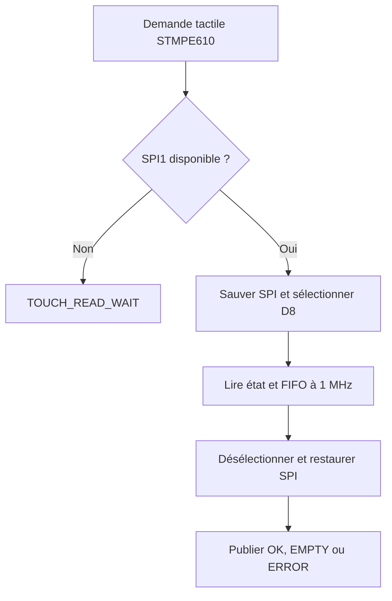
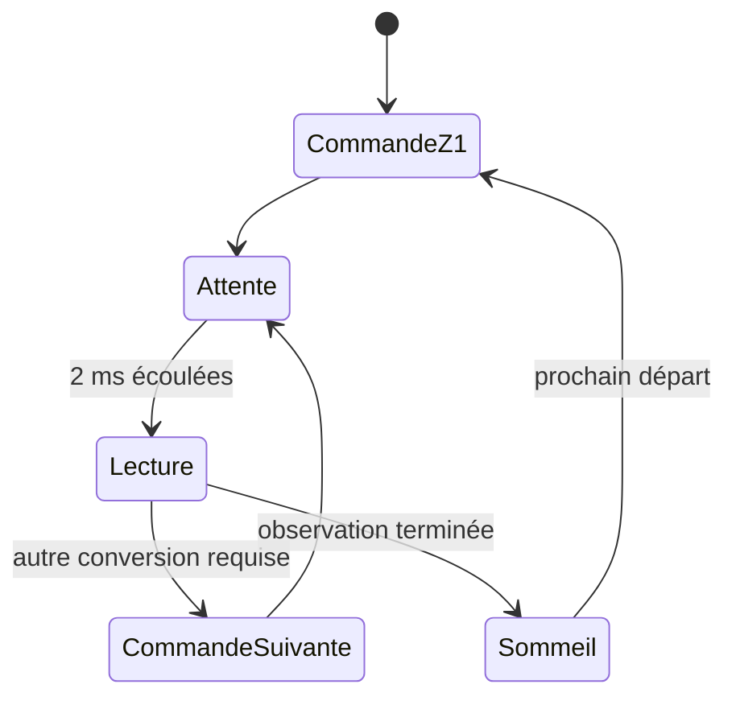
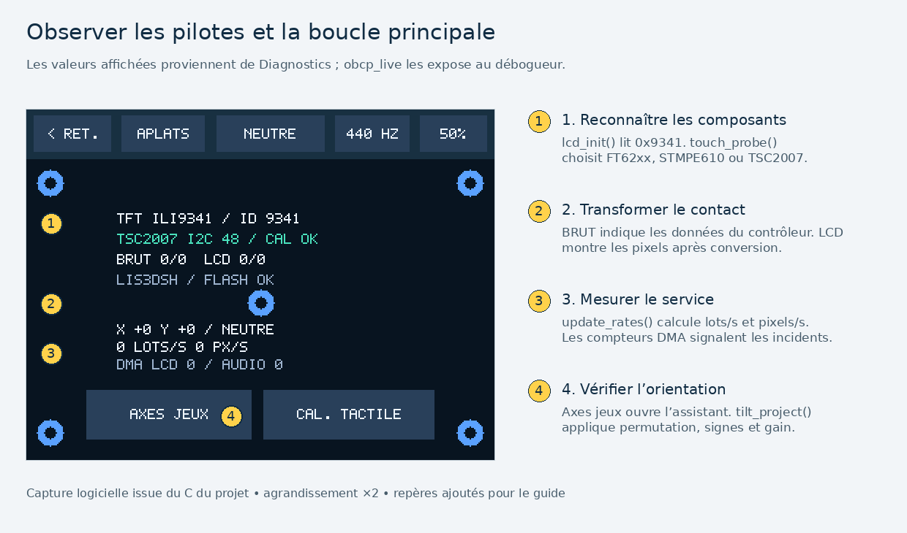

# Du périphérique au modèle applicatif

Un pilote transforme un protocole matériel en une interface C utilisable par le programme. La HAL configure et manipule SPI, I²C, DMA ou timer du STM32. Les pilotes ObCP connaissent les commandes du composant externe. Les modèles de Paint, des jeux et de la musique travaillent ensuite sur des données indépendantes du matériel.

Le [montage matériel](MATERIEL.md) donne le câblage. Ce guide explique le chemin logiciel et les contrats à respecter.

## Carte des responsabilités

| Niveau | Fichiers | Données échangées |
| --- | --- | --- |
| Configuration STM32 | `gpio.c`, `dma.c`, `spi.c`, `i2c.c`, `tim.c`, générés par CubeMX | Handles HAL et registres configurés |
| Composants et ports | `ili9341.c`, `ft6206.c`, `stmpe610.c`, `tsc2007.c`, `accelerometer.c`, `flash_port.c`, `pwm_audio.c` | Transfert écran, contact brut, mesure en g, octets flash, comparaisons PWM |
| Adaptation des entrées | `touch_port.c`, `input.c`, `calibration.c` | Contrôleur reconnu, événements tactiles et commandes normalisées |
| Modèles et interface | `app.c`, `paint.c`, `maze.c`, `breakout.c`, `race.c`, `audio.c` | États et rectangles à recomposer |
| Rendu et persistance | `gfx.c`, `storage.c`, `logo.c` | Bandes RGB565 et objets versionnés |
| Liaison sur la carte | `board.c` | Ordonnancement, diagnostic, callbacks de ports |

Les liens du [répertoire des modules](../README.md#répertoire-du-code) ouvrent chaque source et son en-tête.

## ILI9341, écran SPI et DMA

[ili9341.c](../Core/Src/obcp/ili9341.c) expose `lcd_init`, `lcd_port` et `lcd_spi_available`. `lcd_init` configure le contrôleur, lit son identifiant et établit l’orientation paysage. Le TFT utilise des commandes sur huit bits, sélectionnées par D/C bas, puis des données avec D/C haut.

| Opération | Commande | Données |
| --- | --- | --- |
| Réinitialiser | `0x01` | Attente de démarrage |
| Quitter le sommeil | `0x11` | Attente prescrite par la séquence |
| Activer l’affichage | `0x29` | Aucune charge utile |
| Définir les colonnes | `0x2A` | Début et fin inclus, sur deux octets chacun |
| Définir les lignes | `0x2B` | Début et fin inclus |
| Écrire les pixels | `0x2C` | Deux octets par pixel RGB565 |
| Lire l’identifiant | `0xD3` | Lecture retournant normalement `0x9341` |

Les rectangles logiciels excluent leurs bords droit et bas. `window` convertit donc la fin en `start + length - 1` pour la fenêtre matérielle. Le moteur conserve l’ordre octet fort puis octet faible du RGB565.

L’écriture des pixels se fait à 8 Mbit/s sur SPI1 avec DMA1 canal 3. La lecture d’identifiant ralentit le SPI à 4 Mbit/s. Lire une signature et réussir une transmission HAL renseignent sur des choses différentes. Une mire visible reste le contrôle de bout en bout.

`DisplayPort.send` conserve le tampon jusqu’à la fin du transfert. `poll` renvoie `TRANSFER_BUSY`, `TRANSFER_DONE` ou `TRANSFER_ERROR`. Les callbacks HAL signalent la fin ou l’erreur ; ils ne recomposent pas de nouvelle scène. Le timeout du pilote borne une attente anormale.

## Reconnaître séparément le tactile

[touch_port.c](../Core/Src/obcp/touch_port.c) commence par vérifier la disponibilité de SPI1. Il essaie ensuite FT62xx, STMPE610 et TSC2007 dans cet ordre. Une recherche terminée sans composant reconnu renvoie un `TouchDevice` de type absent. Un bus encore occupé diffère la recherche.

| Contrôleur | Bus et adresse | Critère logiciel | Résultat fourni |
| --- | --- | --- | --- |
| FT62xx du 1947 | I²C1, `0x38` sur 7 bits | Registre de signature accepté, notamment `0x06` pour FT6206 | Premier contact en portrait 240 × 320 |
| STMPE610 du 1651 historique | SPI1, CS sur PA9/D8 | Identifiant `0x0811`, essais des modes de phase pris en charge | Coordonnées ADC sur 12 bits et pression |
| TSC2007 du 1651 récent | I²C1, `0x48` sur 7 bits | Réponse de conversion et format 12 bits plausibles | X, Y, Z1 et Z2 |

Le TSC2007 ne fournit pas de registre d’identification équivalent à celui du STMPE610. La reconnaissance suppose donc un shield connu à l’adresse réservée. Un autre périphérique répondant de manière compatible à `0x48` peut créer une ambiguïté. Ce point est documenté dans `tsc2007_probe` et couvert partiellement par un faux périphérique de format incorrect dans le banc PC.

La présence du tactile ne garantit pas que son repère soit déjà adapté à l’écran. `TouchDevice` donne la famille, `RawTouch` donne l’observation, `TouchCalibration` donne la transformation résistive.

## FT62xx, registres I²C et rotation

[ft6206.c](../Core/Src/obcp/ft6206.c) lit le registre de signature puis le nombre de contacts et les octets du premier point. Le projet exploite un seul doigt. Les coordonnées sont assemblées à partir de champs de registre ; les bits de statut sont masqués.

Les adresses affichées dans ce guide sont sur 7 bits. L’appel HAL utilise `0x38U << 1`, car la convention de cette HAL place l’adresse à partir du bit 1. Le bit lecture/écriture est géré par le périphérique et la HAL.

La conversion paysage applique `x = 319 - raw_y`, `y = raw_x`. Le paramètre `OBCP_TOUCH_FLIPPED` ajoute un demi-tour si le montage le nécessite. Les bornes natives sont contrôlées avant toute soustraction.

## STMPE610, FIFO et partage de SPI1

[stmpe610.c](../Core/Src/obcp/stmpe610.c) sauvegarde les champs de fréquence, polarité et phase du SPI. Il échange à 1 MHz sous CS tactile, remonte ce CS même en cas d’erreur et restaure les réglages du TFT.

La FIFO mémorise des observations. Au plus huit sont retirées par passage, et le dernier point reçu est retenu pour limiter le retard. Une FIFO momentanément vide ne signifie pas que le stylet a quitté la dalle.



Le partage se décide dans la boucle principale. Les deux composants ne doivent jamais être sélectionnés simultanément. À la fin d’une bande, `renderer_task` rend la main avant d’en préparer une autre, ce qui offre une fenêtre au tactile.

## TSC2007, conversions réparties sur plusieurs tours

[tsc2007.c](../Core/Src/obcp/tsc2007.c) conserve un petit état privé `adc`. Une commande lance une conversion. La fonction rend ensuite `WAIT` jusqu’à l’expiration de 2 ms, puis lit deux octets et passe à la mesure suivante.

L’ordre est Z1, Z2, X puis Y. Les mesures liées à la pression permettent de décider si un contact est présent avant de lire sa position. Deux seuils distincts stabilisent l’entrée et la sortie du contact, c’est l’hystérésis.



Les douze bits utiles occupent la partie haute des deux octets reçus. Le décodage est `(bytes[0] << 4) | (bytes[1] >> 4)`. Les quatre bits bas sont contrôlés. Une transaction I²C individuelle peut attendre jusqu’au timeout court de 2 ms ; le pilote est coopératif à l’échelle de la séquence, et ne constitue pas un pilote entièrement asynchrone avec DMA.

## Filtre résistif et calibrage affine

`touch_filter` confirme un changement de contact par deux mesures et utilise la médiane de trois positions par axe. Le calibrage possède sa propre stabilisation, car il doit observer les points bruts sans leur appliquer un ancien profil.

Les trois premières cibles donnent une transformation

```text
x_ecran = x_from_x * x_brut + x_from_y * y_brut + x_offset
y_ecran = y_from_x * x_brut + y_from_y * y_brut + y_offset
```

Les six coefficients représentent rotation, inversion, échelle et décalage. Le déterminant de deux vecteurs bruts doit être assez grand pour éviter un ajustement instable. Six observations proches sont moyennées et le relâchement valide chaque cible.

La quatrième cible, indépendante de l’ajustement, doit présenter au plus 14 pixels d’écart sur chaque axe. En cas d’échec, la session recommence. Deux profils distincts, STMPE610 et TSC2007, sont conservés avec l’orientation TFT dans un objet de 26 octets.

Le profil est stocké sous forme de points bruts, puis ses coefficients sont recalculés au chargement. Cela évite de figer en flash la représentation binaire des flottants du compilateur.

## Accéléromètre, SPI3 et unités

[accelerometer.c](../Core/Src/obcp/accelerometer.c) lit `WHO_AM_I` pour distinguer LIS3DH, signature `0x33`, et LIS3DSH, signature `0x3F`. Il configure une plage de ±2 g et une cadence de 100 Hz. Le mode BDU empêche le remplacement d’une paire de registres pendant sa lecture.

| Capteur | Conversion dans la configuration utilisée | Organisation de lecture |
| --- | --- | --- |
| LIS3DH en haute résolution | 0,0625 mg par LSB du mot signé assemblé | Bit de lecture et auto-incrément adaptés au composant |
| LIS3DSH | 0,06 mg par LSB | Protocole de registres du LIS3DSH |

Les six octets bas/haut donnent trois `int16_t`. Le résultat public `accel_g_t` est exprimé en g. Le zéro logiciel, la zone morte et le sens de l’écran appartiennent ensuite à `input.c`, afin que les jeux ne dépendent pas du modèle du capteur.

## PWM audio, timer et interruptions

[pwm_audio.c](../Core/Src/obcp/pwm_audio.c) utilise TIM1_CH3N sur PB1, DMA1 canal 6, requête UPDATE 7. L’horloge timer est 64 MHz.

| Grandeur | Calcul | Valeur |
| --- | --- | --- |
| Porteuse PWM | `64 000 000 / (0+1) / (1023+1)` | 62 500 Hz |
| Cadence des requêtes UPDATE | `62 500 / (3+1)` | 15 625 Hz |
| Une moitié d’anneau | `256 / 15 625` | 16,384 ms |
| Anneau complet | `512 × 2` octets | 1 024 octets |
| Préparation `staging` | `256 × 2` octets | 512 octets |

Le registre de répétition RCR espace les événements de mise à jour. Il ne réduit pas la fréquence de la porteuse. Le DMA écrit des demi-mots de 16 bits dans CCR3.

L’IRQ incrémente `epoch` ou pose une erreur. La boucle calcule les voix dans `staging`, contrôle l’époque et le compteur DMA, puis copie seulement vers une moitié encore libre. Une marge de huit échantillons protège le moment de la copie. Si la fenêtre est perdue, le compteur d’incidents augmente.

L’arrêt désactive le transport et maintient PB1 à zéro. L’étage analogique et la connexion J13 sont décrits dans [MATERIEL.md](MATERIEL.md#audio--adaptation-de-j13).

## Flash interne, géométrie et ECC

[flash_port.c](../Core/Src/obcp/flash_port.c) transforme un offset logique en adresse physique à partir de `__obcp_storage_start`. Le port vérifie taille du composant, banques non permutées, page de 2 Kio et géométrie de la réserve avant d’autoriser une modification.

La réserve va de `0x080DB800` inclus à `0x080FF800` exclu, soit 144 Kio. Le firmware est borné à la banque 1 par [ObCP_Flash.ld](../Linker/ObCP_Flash.ld). Le plan détaillé figure dans [ARCHITECTURE.md](ARCHITECTURE.md#la-mémoire-de-sauvegarde).

Une lecture peut provoquer une NMI ECC double. `obcp_flash_ecc_nmi` acquitte le drapeau ECCD et mémorise l’incident. Le callback de lecture consulte ce drapeau après sa copie et renvoie l’échec. Une NMI d’une autre origine poursuit le gestionnaire de faute prévu par les sources générées.

La programmation copie les huit octets dans un `uint64_t` local pour respecter son alignement, appelle la HAL puis reverrouille le contrôleur flash. L’algorithme A/B et le CRC restent dans `storage.c`.

## Diagnostic de bout en bout



| Observation | Première donnée à examiner | Fonction à lire |
| --- | --- | --- |
| Écran absent ou mauvais aplats | `lcd_id`, `lcd_io_ok`, broches SPI | `lcd_init`, `command`, `poll_band` du TFT |
| Tactile absent | `touch_ok`, `touch_controller`, `touch_id` | `touch_probe` puis le `probe` du composant |
| Trait coupé | `touch_errors`, résultat WAIT/EMPTY/OK | `sample_touch`, `touch_filter` |
| Position tactile fausse | `touch_raw_x/y` comparés à `touch_x/y` | `touch_landscape` ou `touch_cal_map` |
| Jeu inversé | `tilt_axes`, validité et neutre | `tilt_project`, `tilt_guide_sample` |
| Son interrompu | `audio_missed`, DMA1 canal 6 | `pwm_audio_task`, puis `audio_fill` |
| Sauvegarde refusée | Résultat `StoreResult`, `last_flash_ms` | `storage_save`, `obcp_flash_ready` |

Le banc [test_touch_bus.c](../Tests/test_touch_bus.c) vérifie les échanges avec des faux registres. Il contrôle notamment adresse HAL, délai de conversion, sélection SPI et restitution du mode TFT. Une mesure sur carte complète ces essais pour les niveaux électriques, les fronts SPI, l’écoute et les temps réels.
