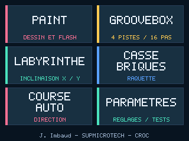
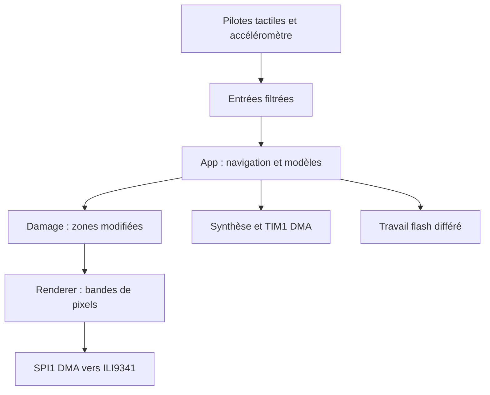
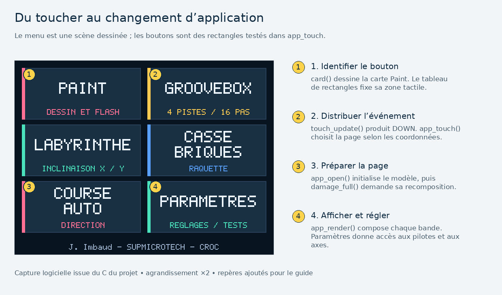
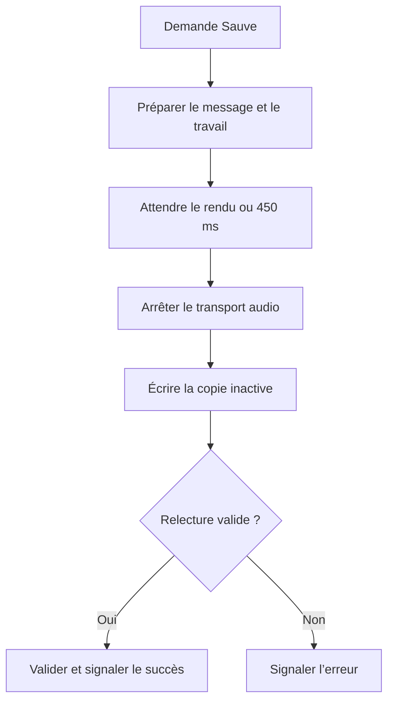
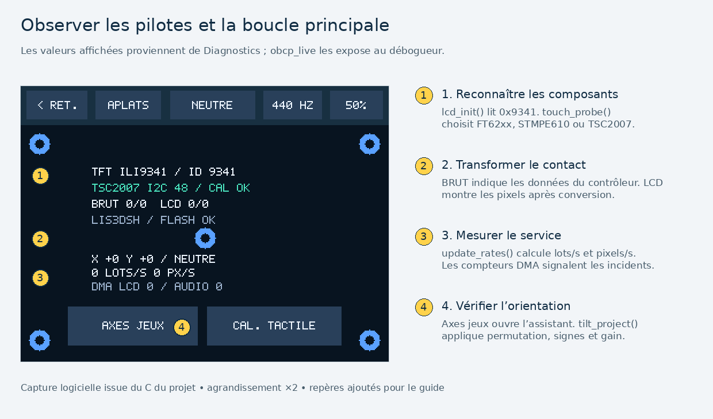
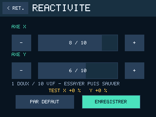
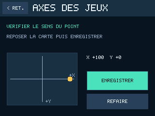
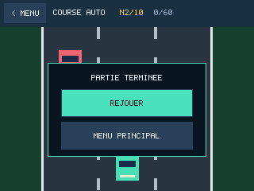

# ObCP tactile · Adafruit 1947 et 1651

**Version 0.4.1 · STM32L476RG · STM32CubeIDE · documentation pédagogique**

Un seul firmware lance un Paint, une groovebox et trois jeux à inclinaison de dix niveaux chacun. Le LIS3DH ou le LIS3DSH pilote les jeux. Le menu **Paramètres** regroupe la réactivité X/Y, le sens des axes, le calibrage tactile et le diagnostic. La flash interne conserve les dessins avec leur palette, les motifs musicaux et les réglages.

À l’allumage, un accueil fixe présente le logo SUPMICROTECH pendant environ 3,2 s, puis ouvre le menu ou le calibrage demandé. Les six boutons du menu partagent leurs dimensions et leur police. La signature **J. Imbaud - SUPMICROTECH - CROC** est centrée en bas.

Le programme lit l’identifiant de l’ILI9341 et reconnaît séparément le tactile. Il accepte le **1947 capacitif FT62xx**, le **1651 résistif TSC2007** et l’**ancien 1651 résistif STMPE610**. Pour les modèles résistifs, le calibrage à quatre cibles est conservé en flash. Le brochage et les ponts à contrôler dépendent de la révision. [Montage matériel](ObCP_Tactile_1947/docs/MATERIEL.md)



*Capture 320 × 240 produite sur PC par le moteur graphique du firmware.*

## Ce qu’apporte la version 0.4.1

Cette version développe la documentation de tout le code applicatif. Les **243 fonctions définies dans les vingt modules C**, dont 126 privées et 117 à liaison externe, ont une description de leur rôle et de leur traitement. Les **115 déclarations d’interface**, les structures et leurs champs, les paramètres, unités, capacités de tampon et codes de retour sont documentés. Les deux callbacks HAL du TFT complètent les fonctions à liaison externe.

Les en-têtes fournissent les contrats Doxygen. Les fichiers C expliquent ensuite les algorithmes et les décisions délicates, notamment le calibrage affine, le masquage des pixels, les collisions, la synthèse DDS, le partage DMA et la validation flash A/B. Les crochets CubeMX, le linker, les tests et les outils Python disposent aussi d’explications. Les composants HAL/CMSIS conservent leur documentation d’origine.

La référence de langage est **C11**, avec la chaîne GNU Arm pour le firmware. **Doxygen est la convention de documentation** utilisée pour extraire les contrats. Le [guide des conventions](ObCP_Tactile_1947/docs/CONVENTIONS.md) précise la portée de ces choix et les vérifications effectuées.

Pour commencer, suivre [le parcours de lecture du code](ObCP_Tactile_1947/docs/LIRE_LE_CODE.md), puis [le guide des pilotes](ObCP_Tactile_1947/docs/PILOTES.md). L’[API HTML déjà générée](ObCP_Tactile_1947/docs/api/index.html) s’ouvre hors connexion après extraction du projet. Sur GitHub, télécharger le dossier ou régénérer les pages pour les consulter dans un navigateur.

## Sommaire

- [Mise en route sur Windows](#mise-en-route-sur-windows-11)
- [Fonctionnement du programme](#fonctionnement-du-programme)
- [Répertoire du code](#répertoire-du-code)
- [Lire les commentaires et l’API](#lire-les-commentaires-et-lapi)
- [Régler la commande des jeux](#régler-la-commande-des-jeux)
- [Jouer et revenir au menu](#jouer-et-revenir-au-menu)
- [Régénérer avec CubeMX](#régénérer-avec-stm32cubemx-autonome)
- [Vérifications reproductibles](#vérifications-reproductibles)
- [Parcours documentaire](#parcours-documentaire)

## Mise en route sur Windows 11

1. Extraire le dossier `ObCP_Tactile_1947` dans un chemin de travail local. Le dossier contient `.project`, `.cproject` et `ObCP_Tactile_1947.ioc`.
2. Vérifier le routage SPI du shield selon le [montage matériel](ObCP_Tactile_1947/docs/MATERIEL.md). Commencer avec l’ObCP alimentée par USB et le shield installé. Le diagnostic écran et tactile se fait avec l’étage audio débranché.
3. Dans STM32CubeIDE, ouvrir **File → Import → General → Existing Projects into Workspace**. Sélectionner le dossier extrait. Choisir **Debug** ou **Release**, puis **Project → Build Project**.
4. Pour le premier chargement, utiliser `binaires/Release/ObCP_Tactile_1947.hex` avec STM32CubeProgrammer ou charger l’ELF Debug via ST-LINK. Sur une carte qui contient déjà un autre projet, relever ou sauvegarder son contenu avant le chargement. Sélectionner un effacement ciblé des pages programme si les données de ce projet doivent survivre à une mise à jour.
5. Après l’accueil, avec un 1651 sans profil en flash, maintenir le doigt au centre de la cible jaune jusqu’à l’indication **Relâcher**. Répéter pour les quatre cibles. La dernière contrôle le calibrage avant sa sauvegarde. **Paramètres → Calibrer** permet de reprendre la mesure.
6. Ouvrir **Paramètres → Diagnostic**. **Aplats** fait défiler le rouge, le vert, le bleu et le blanc. Un cinquième appui revient aux cinq cibles de vérification. **< Ret.** revient aux paramètres, puis **< Menu** au menu principal.

Les sources et commentaires sont en UTF-8. Si les accents sont mal affichés dans CubeIDE, sélectionner **Project → Properties → Resource → Text file encoding → UTF-8**.

Pour mettre à jour une v0.3.0 ou v0.4.0, programmer l’HEX en limitant l’effacement aux pages programme de la **banque 1**. La v0.4.1 relit les dessins, les motifs, le calibrage tactile, les axes et les réglages déjà enregistrés. Le dossier CubeIDE est `ObCP_Tactile_1947`. [Plan mémoire](ObCP_Tactile_1947/docs/ARCHITECTURE.md#la-mémoire-de-sauvegarde)

Pour la programmation USB DFU de l’ObCP, mettre **SW2 sur On**, **SW4 sur Prog** et appuyer sur **SW3**. Choisir **USB** dans CubeProgrammer et charger le fichier HEX. Remettre **SW4 sur Run** et appuyer sur **SW3**. Avec un fichier BIN, l’adresse de départ est `0x08000000`. Pour le SWD, utiliser les signaux de J17 et une référence 3,3 V prise sur la carte. [Procédure ObCP d’origine](https://github.com/jimbaud/LAB_ObCP_L476_STM32CubeIDE/tree/cef4cdae9e7564ef920e2c2c74603c82b863f89c/OBCP_template_2026)

| Application | Prise en main |
| --- | --- |
| Paint | **Taille** propose six diamètres de 1 à 19 px. **Coul.** choisit une case parmi 16, puis **RVB** édite ses composantes de 0 à 255. **Sauve** mémorise le dessin et sa palette. |
| Groovebox | Choisir une piste et activer des cases. **Play** démarre la boucle. **Timb.** change le son de la piste. **Clav.** joue une note et la sélectionne pour les pas saisis ensuite. |
| Labyrinthe | Poser la carte à plat pour le neutre, choisir **Jouer**, puis incliner sur les deux axes jusqu’à la cible verte avant la fin du temps. |
| Casse-briques | L’inclinaison désigne directement une position de raquette. Les derniers niveaux combinent une petite raquette, une balle rapide et des briques à deux impacts. |
| Course auto | Le premier objectif est 50 dépassements. Les motos apparaissent au niveau 3, les fourgonnettes au niveau 5 et les camions au niveau 7. Une collision déclenche l’éclat **BOUM!** pendant 0,9 s. |
| Paramètres | **Réactivité** règle X et Y de 1 à 10. **Axes jeux** règle leur sens. **Calibrer** traite le tactile résistif. **Diagnostic** donne accès aux mires, au neutre et à la note de 440 Hz. |

Le haut-parleur se raccorde aux bornes de l’ampli. L’interface décrite dans [le montage matériel](ObCP_Tactile_1947/docs/MATERIEL.md) récupère la PWM de J13, la filtre et alimente l’entrée audio.

## Fonctionnement du programme

### Démarrer, commander, simuler, dessiner

`main.c` configure les périphériques avec les fonctions générées par CubeMX, appelle une fois `obcp_start()`, puis appelle continuellement `obcp_task()`. Le programme partage le processeur par une boucle coopérative. Les interruptions annoncent des fins de transfert et des incidents, tandis que la boucle effectue les calculs et les actions applicatives.

`App` conserve la page ouverte et les modèles des applications. Un événement tactile change ces données. Les jeux avancent au pas fixe de 20 ms. Toute modification visuelle ajoute des rectangles à `Damage`. `Renderer` recompose ces zones en bandes RGB565 et transmet leurs pixels au TFT par DMA.



### Exemple, toucher Paint



Le contrôleur fournit un contact brut. `sample_touch()` applique le filtre et la conversion de repère. `touch_update()` produit `TOUCH_DOWN`. `app_touch()` repère le bouton et appelle `app_open()` avec `SCREEN_PAINT`. L’ouverture prépare le modèle et demande un écran complet avec `damage_full()`. Aux tours suivants, `app_render()` compose les bandes du nouvel écran.

La commande, le calcul et le dessin sont trois opérations distinctes. Ainsi, `paint_segment()` modifie le canevas, alors que `paint_draw()` ne fait que lire le canevas pour dessiner une bande. Cette organisation permet de tester les applications sur PC avec les mêmes fonctions C.

### Du doigt au pixel

Le FT62xx fournit un repère portrait de 240 × 320 pixels. Le code le tourne en paysage. Les tactiles résistifs fournissent des mesures ADC sur 12 bits. Trois points construisent une transformation affine, une quatrième cible contrôle sa précision. Les coordonnées de menu sont ensuite toujours en pixels, origine en haut à gauche, X vers la droite et Y vers le bas.

| État renvoyé par le pilote tactile | Traitement de la boucle |
| --- | --- |
| `TOUCH_READ_OK` | Exploiter l’observation et construire un événement |
| `TOUCH_READ_WAIT` | Revenir plus tard, car une conversion ou le bus est en attente |
| `TOUCH_READ_EMPTY` | Conserver le dernier contact, faute de nouveau point FIFO |
| `TOUCH_READ_ERROR` | Compter l’échec ; après trois erreurs consécutives, reprendre la reconnaissance |

L’écran complet demanderait 153 600 octets en RGB565. Le tampon du renderer contient seulement 10 240 octets, soit seize lignes. Les primitives limitent leurs écritures à la bande courante. Le CPU reprend ce tampon après la fin confirmée du DMA.

### Pilotes et interfaces

| Fonction matérielle | Interface fournie à l’application | Détail à comprendre |
| --- | --- | --- |
| ILI9341 sur SPI1 | `DisplayPort`, `send` et `poll` | Transfert des octets RGB565, état BUSY/DONE/ERROR |
| Trois familles de tactile | `TouchDevice`, `RawTouch`, `TouchRead` | Reconnaissance séparée du TFT et acquisition par étapes |
| LIS3DH ou LIS3DSH sur SPI3 | `accel_g_t` | Mesures XYZ en g à 100 Hz |
| Flash interne | `Storage`, callbacks `read/erase/program` | Offsets en octets, pages de 2 Kio, double mot de huit octets |
| PWM audio TIM1 | `pwm_audio_task` | Consommation de 15 625 échantillons/s dans un anneau DMA |

Le [guide des pilotes](ObCP_Tactile_1947/docs/PILOTES.md) explique les registres, les adresses I²C, les sélections SPI, les conversions, les erreurs et les échanges avec la HAL. Le guide de lecture suit ensuite chaque donnée jusque dans le modèle.

### Sauvegarder sans perdre la dernière copie valide

`App` prépare une demande explicite de travail. La boucle laisse afficher le message, arrête l’audio puis appelle le service de stockage. Chaque objet dispose de deux copies sur des pages distinctes. La copie inactive est effacée, écrite et contrôlée par CRC. Son marqueur de validation est programmé en dernier.



Le [parcours de lecture](ObCP_Tactile_1947/docs/LIRE_LE_CODE.md#9-comprendre-la-sauvegarde-ab) présente l’en-tête de 32 octets et la chronologie A/B. Les tests injectent des coupures au cours de l’effacement, de la programmation et de la validation.

### Comprendre l’audio et les jeux

La groovebox utilise quatre pistes de seize pas et une cinquième voix de clavier. Des accumulateurs de phase DDS produisent les notes ; un LFSR fournit le bruit des percussions. Le timer génère une porteuse de 62,5 kHz et le DMA renouvelle CCR3 à 15 625 Hz. Les IRQ marquent les moitiés consommées ; la boucle calcule les échantillons.

L’inclinaison est recentrée, filtrée, projetée vers les axes écran puis bornée entre −1 et +1. Le labyrinthe exploite les deux axes. Le casse-briques vise une position de raquette avec X et simule la balle en trois sous-pas. La course applique X au déplacement latéral et adapte le trafic à ses dix niveaux. Les transitions de jeu commandent pause, victoire, défaite et retour au menu.

### Lire le diagnostic



Les champs affichés sont conservés dans `Diagnostics`. La structure volatile `obcp_live` en expose les valeurs et les compteurs au débogueur. Elle permet de distinguer identifiant TFT, reconnaissance tactile, position brute, position convertie, état d’inclinaison et incidents de transfert. Les [tableaux de diagnostic](ObCP_Tactile_1947/docs/MATERIEL.md#distinguer-lécran-et-le-tactile) relient les symptômes aux mesures.

## Répertoire du code

Lire d’abord l’en-tête pour connaître le contrat, puis le fichier C pour suivre le traitement. Les chemins ci-dessous sont ceux du projet extrait et des liens GitHub.

| Source | Interface | Responsabilité et premières fonctions à lire |
| --- | --- | --- |
| [main.c](ObCP_Tactile_1947/Core/Src/main.c) | [obcp_board.h](ObCP_Tactile_1947/Core/Inc/obcp_board.h) | Ordre d’initialisation et boucle ; `obcp_start`, `obcp_task` |
| [board.c](ObCP_Tactile_1947/Core/Src/obcp/board.c) | [obcp_board.h](ObCP_Tactile_1947/Core/Inc/obcp_board.h) | Ordonnancement ; `sample_touch`, `sample_inputs`, `update_rates` |
| [app.c](ObCP_Tactile_1947/Core/Src/obcp/app.c) | [obcp_app.h](ObCP_Tactile_1947/Core/Inc/obcp_app.h) | Pages, événements et dialogues ; `app_open`, `app_touch`, `app_step`, `app_render` |
| [gfx.c](ObCP_Tactile_1947/Core/Src/obcp/gfx.c) | [obcp_gfx.h](ObCP_Tactile_1947/Core/Inc/obcp_gfx.h) | Géométrie et rendu ; `gfx_pixel`, `damage_add`, `renderer_task` |
| [ili9341.c](ObCP_Tactile_1947/Core/Src/obcp/ili9341.c) | [obcp_panel.h](ObCP_Tactile_1947/Core/Inc/obcp_panel.h) | Écran et DMA SPI1 ; `lcd_init`, `send_band`, `poll_band` |
| [touch_port.c](ObCP_Tactile_1947/Core/Src/obcp/touch_port.c) | [obcp_panel.h](ObCP_Tactile_1947/Core/Inc/obcp_panel.h) | Façade de détection ; `touch_probe`, `touch_read` |
| [ft6206.c](ObCP_Tactile_1947/Core/Src/obcp/ft6206.c) | [touch_drivers.h](ObCP_Tactile_1947/Core/Src/obcp/touch_drivers.h) | Registres capacitifs ; `ft6206_probe`, `ft6206_sample` |
| [stmpe610.c](ObCP_Tactile_1947/Core/Src/obcp/stmpe610.c) | [touch_drivers.h](ObCP_Tactile_1947/Core/Src/obcp/touch_drivers.h) | Résistif SPI et FIFO ; `stmpe610_probe`, `stmpe610_sample` |
| [tsc2007.c](ObCP_Tactile_1947/Core/Src/obcp/tsc2007.c) | [touch_drivers.h](ObCP_Tactile_1947/Core/Src/obcp/touch_drivers.h) | Résistif I²C ; `tsc2007_probe`, `tsc2007_sample` |
| [input.c](ObCP_Tactile_1947/Core/Src/obcp/input.c) | [obcp_input.h](ObCP_Tactile_1947/Core/Inc/obcp_input.h) | Événements, filtres et axes ; `touch_update`, `tilt_sample`, `tilt_project` |
| [calibration.c](ObCP_Tactile_1947/Core/Src/obcp/calibration.c) | [obcp_calibration.h](ObCP_Tactile_1947/Core/Inc/obcp_calibration.h) | Cibles et transformation affine ; `touch_cal_fit`, `touch_cal_sample` |
| [accelerometer.c](ObCP_Tactile_1947/Core/Src/obcp/accelerometer.c) | [accelerometer.h](ObCP_Tactile_1947/Core/Inc/accelerometer.h) | Capteur SPI3 ; `accel_init`, `accel_read` |
| [paint.c](ObCP_Tactile_1947/Core/Src/obcp/paint.c) | [obcp_paint.h](ObCP_Tactile_1947/Core/Inc/obcp_paint.h) | Canevas et palette ; `paint_segment`, `paint_draw`, `paint_save` |
| [maze.c](ObCP_Tactile_1947/Core/Src/obcp/maze.c) | [obcp_games.h](ObCP_Tactile_1947/Core/Inc/obcp_games.h) | Bille et murs ; `maze_solid`, `maze_step` |
| [breakout.c](ObCP_Tactile_1947/Core/Src/obcp/breakout.c) | [obcp_games.h](ObCP_Tactile_1947/Core/Inc/obcp_games.h) | Raquette et impacts ; `move_ball`, `breakout_step` |
| [race.c](ObCP_Tactile_1947/Core/Src/obcp/race.c) | [obcp_games.h](ObCP_Tactile_1947/Core/Inc/obcp_games.h) | Trafic et collision ; `spawn`, `race_step`, `draw_crash` |
| [audio.c](ObCP_Tactile_1947/Core/Src/obcp/audio.c) | [obcp_audio.h](ObCP_Tactile_1947/Core/Inc/obcp_audio.h) | Voix et séquenceur ; `render_voice`, `audio_fill`, `book_encode` |
| [pwm_audio.c](ObCP_Tactile_1947/Core/Src/obcp/pwm_audio.c) | [obcp_pwm.h](ObCP_Tactile_1947/Core/Inc/obcp_pwm.h) | Transport timer/DMA ; `start`, `half_done`, `pwm_audio_task` |
| [storage.c](ObCP_Tactile_1947/Core/Src/obcp/storage.c) | [obcp_storage.h](ObCP_Tactile_1947/Core/Inc/obcp_storage.h) | Copies A/B ; `inspect`, `active_copy`, `storage_save` |
| [flash_port.c](ObCP_Tactile_1947/Core/Src/obcp/flash_port.c) | [obcp_flash.h](ObCP_Tactile_1947/Core/Inc/obcp_flash.h) | HAL flash et ECC ; `obcp_flash_ready`, `flash_program` |
| [logo.c](ObCP_Tactile_1947/Core/Src/obcp/logo.c) | [obcp_logo.h](ObCP_Tactile_1947/Core/Inc/obcp_logo.h) | Ressource RLE ; `logo_draw` |

| Autres éléments | Rôle |
| --- | --- |
| [obcp_config.h](ObCP_Tactile_1947/Core/Inc/obcp_config.h), [obcp_touch.h](ObCP_Tactile_1947/Core/Inc/obcp_touch.h) | Orientation initiale et types communs du tactile |
| [ObCP_Flash.ld](ObCP_Tactile_1947/Linker/ObCP_Flash.ld) | Placement programme, RAM et réserve de sauvegarde |
| [Tests/test_obcp.c](ObCP_Tactile_1947/Tests/test_obcp.c), [Tests/test_touch_bus.c](ObCP_Tactile_1947/Tests/test_touch_bus.c) | Scénarios pédagogiques, flash simulée, faux bus et captures |
| [Tools/verif_cubemx.py](ObCP_Tactile_1947/Tools/verif_cubemx.py) | Contrôle du projet, des crochets et du placement de l’image |
| [Tools/verif_documentation.py](ObCP_Tactile_1947/Tools/verif_documentation.py) | Contrôle des contrats extraits dans le XML Doxygen |
| [Tools/generer_captures.py](ObCP_Tactile_1947/Tools/generer_captures.py) | Conversion PPM vers PNG et planches annotées |
| [Tools/import_logo.py](ObCP_Tactile_1947/Tools/import_logo.py), [modèle C](ObCP_Tactile_1947/Tools/templates/logo.c.in) | Conversion et compression du logo en conservant ses commentaires |

## Lire les commentaires et l’API

`@brief` résume le rôle. `@param[in]` décrit une donnée lue, `@param[out]` un résultat et `@param[in,out]` un état modifiable. `@return` explique les résultats possibles. Les unités et les capacités attendues sont précisées dans le texte. `/**< ... */` rattache une explication au champ qui précède.

Pour un débutant, commencer par `Rect`, `TouchEvent` et `Paint`, puis suivre une commande depuis `app_touch`. Le [parcours de lecture](ObCP_Tactile_1947/docs/LIRE_LE_CODE.md) explique les pointeurs, structures, masques de bits, unités et contextes d’exécution à mesure qu’ils apparaissent.

Avec Doxygen et Graphviz installés, exécuter depuis le dossier projet.

```bash
doxygen Doxyfile
python3 Tools/verif_documentation.py
```

Ouvrir `build/documentation/html/index.html`. Les pages regroupent les modules, leurs types, leurs fonctions et leur code source commenté. Les graphes d’appels aident à suivre les dépendances. La copie générée livrée est dans `docs/api`. La configuration signale les descriptions et paramètres manquants, et le contrôle XML déduplique chaque fonction entre sa déclaration et sa définition.

Les [conventions de code et de documentation](ObCP_Tactile_1947/docs/CONVENTIONS.md) donnent les règles détaillées, leurs limites et les références officielles C11 et Doxygen.

## Régler la commande des jeux

Dans **Paramètres → Réactivité**, les axes X et Y se règlent indépendamment de 1 à 10. Une valeur élevée augmente le gain et réduit le lissage. Le défaut est **6/10** sur chaque axe. Le réglage agit immédiatement, puis **Enregistrer** le conserve en flash. Le casse-briques et la course utilisent X. Le labyrinthe utilise les deux axes.



Pour adapter le sens au montage, ouvrir **Paramètres → Axes jeux**. Garder l’écran en paysage face à soi.

1. Poser la carte à plat et toucher **Mesurer**.
2. Quand l’écran le demande, abaisser le bord droit de la carte et tenir cette position. Reposer la carte à plat au signal.
3. Abaisser le bord du bas et attendre l’aperçu. Vérifier que le point jaune suit le bord abaissé. Choisir **Refaire** pour recommencer.
4. Reposer la carte à plat et toucher **Enregistrer**. Les trois jeux utilisent ce réglage, conservé au redémarrage. **Paramètres → Diagnostic → Neutre** reprend la position de repos.



Avec un calibrage résistif qui empêche de viser les boutons, maintenir un doigt sur la dalle dès la mise sous tension ou le reset jusqu’à l’apparition du guide, puis relâcher avant de viser la première cible. Ce secours s’active après environ 1,3 s de contact continu quand le contrôleur résistif est reconnu.

La LED verte s’allume pendant 300 ms après une initialisation ou une opération de stockage réussie. Une erreur produit un signal rouge de 500 ms. La LED reste éteinte entre les événements.

## Jouer et revenir au menu

| Jeu | Niveau 1 | Niveau 10 |
| --- | --- | --- |
| Labyrinthe | 22 déplacements au plus court, 75 s | 74 déplacements, 23 s |
| Casse-briques | 16 briques, raquette de 72 px | 32 briques renforcées, raquette de 26 px |
| Course auto | 50 dépassements, un véhicule toutes les 1,10 s | 300 dépassements, toutes les 0,36 s |

Après une défaite, **Rejouer** reprend le niveau en cours et **Menu principal** quitte le jeu. Après une victoire, **Niveau suivant** poursuit la progression. À la dernière victoire, **Recommencer** repart au niveau 1, comme une nouvelle ouverture depuis le menu. Le bouton **Menu principal** est aussi disponible en pause. Pendant le bref éclat de collision de la course, **< Menu** reste accessible dans le bandeau.

Le [guide des jeux et du dessin](ObCP_Tactile_1947/docs/JEUX_ET_DESSIN.md) présente les dix niveaux de chaque jeu, les réglages, les tailles de trait et l’édition RVB. La palette contient 16 couleurs personnalisables. Modifier une case recolore tous les traits qui l’utilisent.



## Régénérer avec STM32CubeMX autonome

La configuration de référence utilise **STM32CubeMX 6.11.1** et **STM32CubeL4 V1.18.1**. CubeIDE 2.0 ouvre le projet de compilation, CubeMX autonome ouvre le `.ioc`. Dans **Project Manager → Code Generator**, laisser **Keep User Code when re-generating** actif. Le réglage **Generate peripheral initialization as a pair of .c/.h files per peripheral** est utilisé. Faire la première régénération sur une copie du projet.

Dans CubeMX, ouvrir le `.ioc`, vérifier les versions puis choisir **Generate Code**. Exécuter ensuite ces commandes dans PowerShell depuis le dossier projet.

```powershell
python .\Tools\verif_cubemx.py
```

Si CubeMX a changé l’option `-T` de CubeIDE, la commande ci-dessous la rétablit vers `Linker/ObCP_Flash.ld` en Debug et Release. Recharger ensuite le projet dans CubeIDE avant de reconstruire.

```powershell
python .\Tools\verif_cubemx.py --retablir-lien
```

Le script de liaison est conservé dans `Linker/`. Il borne le firmware à la banque 1 et expose les symboles des pages de données. Le code applicatif est dans `Core/Src/obcp/` et les crochets restent dans les blocs `USER CODE` de `main.c` et `stm32l4xx_it.c`. La vérification compare le brochage, les requêtes DMA, les crochets et le script de liaison.

La commande officielle **generate code** de CubeMX a permis de régénérer les sources sur une copie propre. Le journal d’essai et la recette précisent la portée de cette vérification. [Recette et résultats](ObCP_Tactile_1947/docs/RECETTE.md) · [Documentation CubeMX](https://www.st.com/en/development-tools/stm32cubemx.html)

## Vérifications reproductibles

Avec GNU Arm Embedded sur Linux, macOS ou WSL, lancer `make -j` pour Release et `make DEBUG=1 -j` pour Debug. Les sorties sont dans `build/Release` et `build/Debug`. Le Makefile et CubeIDE utilisent le même script de liaison.

```bash
make -C Tests test
make -C Tests captures
python3 -m pip install Pillow
python3 Tools/generer_captures.py
python3 Tools/verif_cubemx.py --hex build/Release/ObCP_Tactile_1947.hex --map build/Release/ObCP_Tactile_1947.map
```

Le banc sur PC vérifie les trois pilotes sur des bus simulés, les huit orientations de l’inclinaison, les niveaux et les transitions de jeu, les commandes tactiles du diagnostic, les interruptions de sauvegarde, le tempo et le rendu. Les PNG de la documentation proviennent du moteur graphique de `make -C Tests captures`. Pour un essai sur carte, utiliser la fiche de recette et les variables `obcp_live` dans les **Live Expressions** de CubeIDE.

## Parcours documentaire

| Document | Contenu |
| --- | --- |
| [Montage matériel](docs/MATERIEL.md) | Brochage ObCP, révisions 1947 et 1651, ponts SPI, alimentation et interface J13. |
| [Lire le code pas à pas](docs/LIRE_LE_CODE.md) | Parcours pour débutant, données, fonctions, traitements, manipulations et autoévaluation. |
| [Guide des pilotes](docs/PILOTES.md) | HAL, commandes, registres, acquisition, DMA et diagnostic de bout en bout. |
| [Conventions C et Doxygen](docs/CONVENTIONS.md) | Contrats, pointeurs, unités, propriété des tampons et vérification de documentation. |
| [API HTML](docs/api/index.html) | Référence générée consultable hors connexion, structures, fonctions et graphes d’appels. |
| [Architecture](docs/ARCHITECTURE.md) | Boucle coopérative, rendu DMA, inclinaison, mémoire et synthèse. |
| [Ateliers guidés](docs/ATELIERS.md) | Manipulations progressives, captures et autoévaluation. |
| [Jeux, paramètres et dessin](docs/JEUX_ET_DESSIN.md) | Dix niveaux par jeu, réactivité X/Y, accueil, palettes RVB et migration. |
| [Recette](docs/RECETTE.md) | Vérifications effectuées, résultats et mesures sur carte. |
| [Suivi](docs/SUIVI.md) | Lots du projet, retours d’essai et évolution v0.4.1. |
| [Provenance](docs/PROVENANCE.md) | Base de code, licences et références techniques. |
| [Historique](CHANGELOG.md) | Évolutions livrées de la première version à la v0.4.1. |
